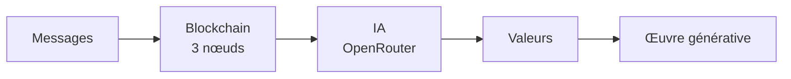

# Une chaîne, trois regards

> Une blockchain de messages, lus par une IA, qui génère une œuvre d'art.

Projet de BUT MMI 3, parcours développement web (SAÉ 5D.01), IUT de Béziers, 2026-2027.

**Statut : conception (S48).** Le code commence en S50, aucune technologie n'est encore arrêtée.

## Le concept

Ce schéma présente le principe général. L’IA est hors chaîne dans la spec v1.0 : chaque binôme lit les messages et garde ses propres valeurs.

Trois binômes partagent une seule chaîne, avec un nœud chacun. Chaque binôme en tire sa propre œuvre. Ce dépôt est celui de **notre binôme**. Il accueille aussi la spec commune aux six.

## Documentation

| Document | Portée | Échéance | État |
|---|---|---|---|
| [Spec commune](docs/spec-commune/README.md) | Les six | 26/11, 12h30 | v1.0 validée |
| [Dossier de binôme](docs/dossier-binome/README.md) | Binôme | 27/11, 17h | Brouillon v0.4 |
| [Charte éditoriale](docs/charte-editoriale/README.md) | Binôme | 27/11, 17h | Brouillon v0.4 |
| [Bible DA](docs/bible-da/README.md) | Binôme | 27/11, 17h | À rédiger |
| [Backlog et plan](docs/backlog/README.md) | Binôme | 27/11, 17h | À rédiger |
| [Test des valeurs](docs/test-valeurs/README.md) | Binôme | | Grille validée |
| [Point d’avancement](docs/suivi/point.md) | Binôme | | 23/11 |

## Calendrier

| Semaine | Phase | Jalon |
|---|---|---|
| S48, 23 au 27/11 | Conception, sans code | Spec et rendus |
| S50, 7 au 11/12 | Production | 10/12 : jonction des trois nœuds |
| S2, 11 au 15/01 | Finalisation | Soutenance orale |

## Outils imposés

- **Tailscale** : réseau privé entre les nœuds
- **OpenRouter** : modèles d'IA gratuits
- **GitHub** : versionnement

## Équipe

[@MaxX-J](https://github.com/MaxX-J) et [@withRen](https://github.com/withRen)

Règles de travail : [CONTRIBUTING.md](CONTRIBUTING.md).
