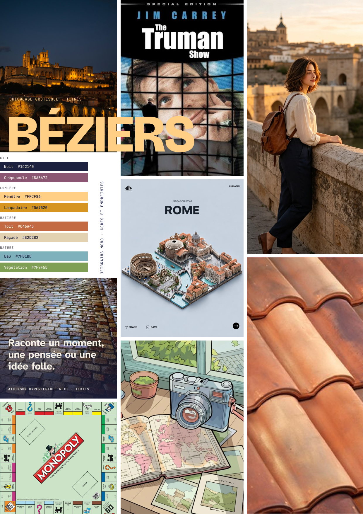
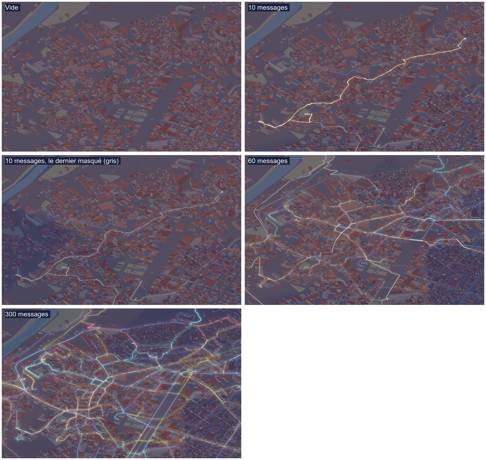
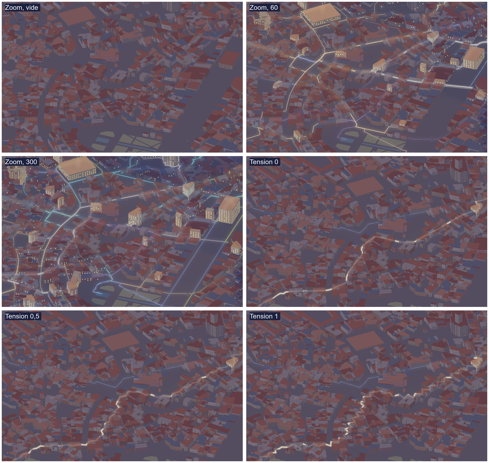
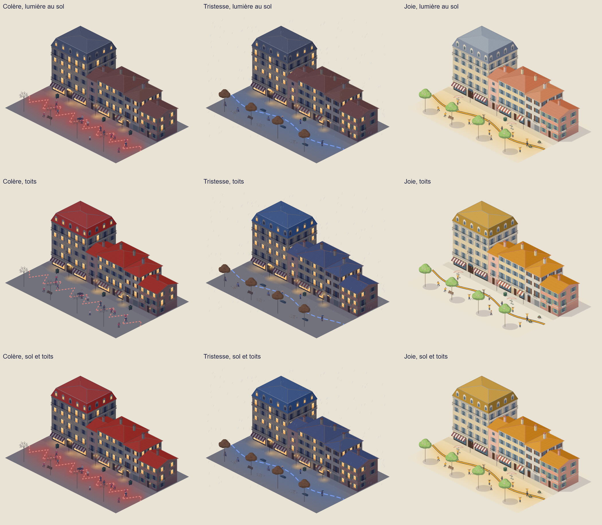
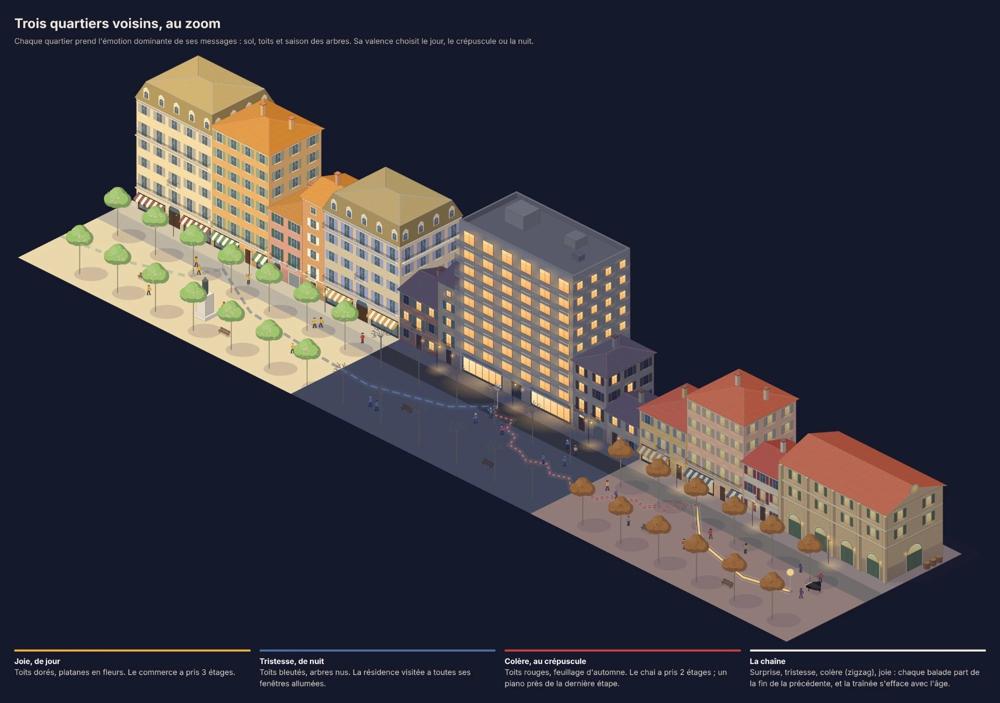
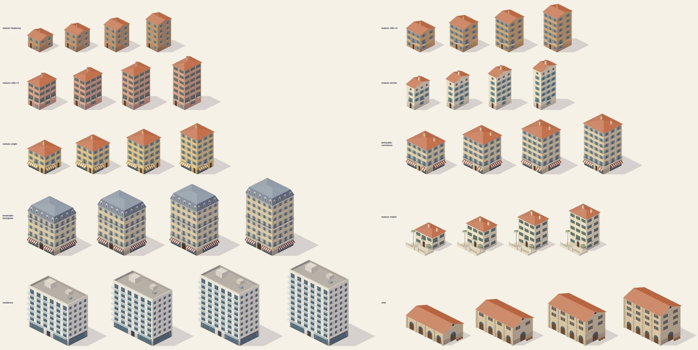

# Bible DA : balade béziers

Binôme 2 (noeud-b) : Maxens Sevilla et Rahim Tamhaev.

**Version 1.0 du 27/11/2026**, validée à deux. Fond de carte : © les contributeurs OpenStreetMap (ODbL).

**En une phrase.** Chaque message devient une balade dans Béziers ; chaque balade repart d'où la précédente s'est arrêtée, et ensemble elles dessinent le Béziers que les gens ressentent.

## 1. Intention

**Ce que l'œuvre doit faire ressentir.**

| Moment | Sensation | Comment |
| --- | --- | --- |
| On écrit | La confiance, puis le poids des mots | Une question simple, un avertissement clair : ce message ne s'effacera pas |
| On attend | La curiosité | Une ville se construit, étape par étape |
| On découvre sa balade | « C'est la mienne » | Un signe unique, un chemin dans de vraies rues, au bout de la chaîne |
| On regarde la ville | D'être un parmi d'autres | Une seule ligne qui traverse la ville, des rues qui s'allument, des bâtiments qui grandissent |
| On revient | L'attachement | La ville a changé, sa balade est toujours là |

**Notre regard sur la chaîne.** Une blockchain garde des paroles qu'on n'efface pas, chaque bloc accroché au précédent. Notre ville fait pareil : **une seule balade continue**, chaque message part de la dernière étape du précédent. Un *bloc* de la chaîne est un *bloc* de maisons. Les messages des trois binômes passent dans la même ville, sous les mêmes règles.

**Pourquoi Béziers.** C'est notre lieu. Les rues, les bâtiments et les repères sont vrais : le visiteur peut reconnaître son quartier, ce qui rend l'abstrait (une émotion lue par une IA) très concret. Piste donnée par l'enseignante d'art, choisie par nous deux ; balade individuelle puis carte commune approuvées par les enseignants.

**Ce que nous refusons.** Juger le visiteur, le suivre, donner une adresse, se moquer d'un lieu de culte ou de mémoire, et une œuvre qu'on ne peut pas lire sans voir les couleurs.

**Écarté.** Une planche de BD, une galaxie, un visage, une forêt, des flèches, une ville de nuit générique : testés en esquisses. Puis des balades séparées : à 300, elles faisaient un fouillis. Béziers l'emporte parce que la donnée y a déjà une place, la rue.

## 2. Moodboard

### La planche

Huit images choisies à deux, une planche validée le 27/11.

| N° | Image | Ce que nous en prenons |
| --- | --- | --- |
| 01 | Béziers de nuit, la cathédrale et le pont Vieux | La vraie ville, ses repères allumés, la nuit |
| 02 | L'affiche de *The Truman Show* | Une ville construite, qu'on regarde vivre |
| 03 | Rome en maquette isométrique | Une ville entière posée sur un socle : notre rendu 2,5D |
| 04 | Des pavés mouillés | La rue qui garde la lumière de ceux qui passent |
| 05 | Des tuiles canal | La matière et la couleur des toits |
| 06 | Une marcheuse sur un pont | La balade, au pas, pas la course |
| 07 | Un plateau de Monopoly | Une couleur par lieu, des maisons qui s'ajoutent |
| 08 | Un carnet de voyage illustré | La carte et le souvenir d'une balade |

**Les couleurs**, une fois chacune, classées en quatre familles : ciel (nuit #1C2140, crépuscule #8A5672), lumière (fenêtre #FFCF86, lampadaire #D69520), matière (toit #C46A43, façade #E2D2B2), nature (eau #7FB1BD, végétation #7F9F55). Toutes viennent de la palette v3.2.

**Les polices** sont posées sur la planche, comme dans l'œuvre : le titre en Bricolage Grotesque, la consigne en Atkinson Hyperlegible Next, les codes en JetBrains Mono.

### Les systèmes

Nous regardons aussi des **systèmes** : pour chaque référence, comment l'image est fabriquée, avant ce qu'elle montre.

| Référence | Comment l'image est fabriquée | Ce que nous retenons | Ce que nous ne prenons pas |
| --- | --- | --- | --- |
| Vera Molnár (cours) | Quelques éléments simples, des règles et des pourcentages de hasard | Peu de règles, beaucoup de résultats | Le hasard pur : chez nous, la donnée décide |
| Visit Nordkyn, Neue (cours) | Une forme fixe, que le vent et la température changent | Idée, système, zones, puis la donnée : notre planche du signe | Sa forme hexagonale |
| MIT Media Lab, TheGreenEyl (cours) | Trois formes dans une grille de 4 × 4 invisible, 12 combinaisons de couleurs, environ 40 000 logos par combinaison | Une grille fixe, un signe par personne | Ses formes |
| Jardin virtuel de Qubo Gas (cours) | Un jardin qui change selon la météo, en temps réel | Une donnée extérieure change un paysage familier | Le temps réel météo |
| Strava | Des parcours superposés : plus on passe, plus le chemin se voit | Les rues qui s'allument sous les passages | Le suivi des personnes : nous n'utilisons aucune position |
| Plan de métro | Une géographie simplifiée en lignes, couleurs et étapes | Étapes, lignes, lecture rapide | L'abstraction : nos rues restent vraies |
| Monopoly | Un plateau où un lieu a une couleur et une pièce posée dessus | Les familles de lieux, les repères en volume, les maisons qui s'ajoutent | Son dessin et son argent |
| Google Maps | Le zoom révèle des détails, niveau par niveau | Trois niveaux : ville, quartier, lieu | L'aspect, la recherche, les données personnelles |

Ces références viennent du cours d'art génératif et des échanges avec l'enseignante. Nous nous en inspirons sans reprendre de dessin.

## 3. Ambiance colorée

**L'idée.** La ville est la **matière** ; l'émotion est la **lumière** posée dessus : sur le sol et les toits du quartier, et dans les rues où la chaîne passe. Palette **fermée**, détaillée dans [palette.md](palette.md).

| Groupe | Teintes | Donnée qui choisit | Usage |
| --- | --- | --- | --- |
| Matières de Béziers | Enduits, tuiles, zinc, volets, végétation, eau : 30 de jour | `valence` du quartier, en trois lumières | Bâtiments, sol, eau |
| Émotions | 7 teintes × 5 crans | `emotion`, `intensite` | Tracé, rues, sol et toits du quartier, vêtements des passants |
| Bâtiments visités | Une teinte chaude | Nombre de visites | Façades et fenêtres des bâtiments qui grandissent |
| Familles de lieux | 10 familles × 3 tons | `lieu` | Symbole, liseré |
| Interface | Encre, papier, gris | Aucune | Panneaux, boutons |

| joie | tristesse | colere | peur | surprise | degout | neutre |
| --- | --- | --- | --- | --- | --- | --- |
| #F2B134 | #4F6FA8 | #C8413A | #5E3C8A | #2FA3A0 | #9AA53A | #9A948A |
| trait plein, épais | longs tirets | tirets courts | points | tiret et point | double trait | trait plein, fin |

**Elle tient à 3 comme à 300.** Un quartier ne prend qu'**une** émotion à la fois, celle qui domine chez lui. Les teintes de la ville restent proches et calmes. Une rue ne garde que la couleur de son dernier passage. Sur la carte, un seul tracé est fort à la fois : la tête de la chaîne, ou la balade choisie.

**Chaque choix.**

- Les couleurs de la ville sont observées à Béziers et reprises des bâtiments dessinés.
- Sept émotions testées par calcul : écart d'au moins 5 dans trois daltonismes simulés (crans 0,5 à 1), et au moins 10 la nuit.
- Le motif double la couleur : on lit l'émotion sans la couleur.
- Un liseré encre garde le tracé lisible le jour et au crépuscule (contraste 10 et 6,4).
- Validé le 26/11 par MaxX-J : peur et dégoût avec le liseré, `eau` en bleu ciel et `savoir` en gris sauge, `commerce` et `habitat` gardés.
- Toutes les lumières (sol, toits, rues) viennent des teintes de la palette, jamais d'une teinte à part.

## 4. Typographie

| Famille | Rôle | Pourquoi |
| --- | --- | --- |
| Bricolage Grotesque | Titres (64, 36, 24) | Une enseigne de rue : ronde, un peu irrégulière |
| Atkinson Hyperlegible Next | Textes et interface (18, 15) | Dessinée pour les lecteurs malvoyants |
| JetBrains Mono | Empreintes (15) | Chasse fixe : on compare caractère par caractère |

**Lisible ou texture ?** Lisible, toujours. Le message se lit dans un panneau, en 18 px. Sur la carte, **aucun mot** : la ville, les symboles et les tracés parlent. Nous avons écarté le texte comme texture, car un message mérite d'être lu, et parce que notre esquisse de flèches avec des mots devenait illisible à 300.

Jamais moins de 15 px. Contraste AA au moins. Les trois familles sont choisies (MaxX-J, 26/11).

## 5. Symbole

| | Emblème | Signe |
| --- | --- | --- |
| Forme | La colline de Béziers, le clocher de Saint-Nazaire, une balade autour | Un pâté de maisons de 4 × 4 traversé par une balade |
| Change | Jamais | À chaque message |
| Où | Onglet, en-tête, accueil, documents | Fin de l'attente, carte de balade, liste |

**L'emblème** vient d'une idée de withRen, simplifiée : une seule couleur, une signature verticale et horizontale, inverse, sur papier, sur la nuit, et un favicon (le clocher et un arc) lisible à 16 px. Nom : « balade béziers ».

**Le signe** répond à un système fixe que la donnée déforme :

| Fixe | Change |
| --- | --- |
| Grille de 4 × 4, entrée à gauche, sortie à droite, maisons basses devant | Le nombre de virages (`tension`), la hauteur générale (`energie`), un objet incongru posé dans la grille (`absurdite`), la couleur de la rue (`emotion`), la lumière (`valence`) |
| | L'`id` : couleur des façades (matières de la palette), hauteur de chaque maison, place des maisons et de la rue, **toujours dans la grille** |

Le même message redonne toujours le même signe. Planches : [emblème](https://www.figma.com/design/ryY2ksOgkdLQXyIwtDPPKw/Sans-titre?node-id=39-128) et [construction](https://www.figma.com/design/ryY2ksOgkdLQXyIwtDPPKw/Sans-titre?node-id=33-91). Détails : [identite.md](identite.md).

## 6. Règles génératives

### Du message à la balade

| Donnée | Plage | Règle |
| --- | --- | --- |
| Message précédent | | La balade part de sa dernière étape |
| `lieu`, `lieu_secondaire` | 10 familles | Familles des étapes ; le vrai lieu vient de l'`id` |
| `energie` | 0 à 1 | 2 à 6 étapes |
| `emotion` | 7 | Couleur et motif du tracé, couleur des rues traversées |
| `intensite` | 5 crans | Force de la couleur |
| `tension` | 5 crans | Tracé souple à zigzag serré, **toujours dans la largeur de la rue** |
| `absurdite` | 0 à 1 | À partir de 0,5, un objet incongru (piano, baignoire, taureau, poisson volant) apparaît près d'une étape ; à 1, près de chaque étape, trois au plus |
| `id` | Empreinte SHA-256 | Choisit les lieux, l'objet incongru et les détails, toujours pareil |

Les chemins suivent les vraies rues d'OpenStreetMap, du plus court chemin d'une étape à l'autre. Repasser au même endroit est permis. Pour garder une balade lisible, une étape suit la précédente à 600 m au plus à vol d'oiseau, et le trajet entier fait 2,5 km au plus ; au-delà, le code prend le lieu suivant de la famille, toujours choisi par l'id. Quand l'IA a échoué, la balade est tracée avec les valeurs par défaut de la charte : deux étapes vers des repères proches, trait gris neutre, sans effet sur la ville. `ambiance` est retirée (MaxX-J, 26/11).

**L'ordre** est celui de la chaîne : un message est tracé une fois dans un bloc, puis ne bouge plus tant que la chaîne ne change pas. Si la chaîne change, la balade est recalculée.

### De la balade à la ville

Un quartier regarde ses **20 derniers messages**, quel que soit le binôme.

| Donnée | Plage | Règle |
| --- | --- | --- |
| Moyenne de `valence` du quartier | 0,12 ou plus | Jour |
| | Entre -0,12 et 0,12 | Crépuscule (jour et nuit superposés) |
| | -0,12 ou moins | Nuit |
| | Aucun message | Jour |
| Émotion la plus fréquente du quartier | 7 | Lumière au sol et teinte des toits de **tout le quartier** ; à égalité, la plus récente. Force : moyenne des `intensite`. Colère : sol seulement, les toits gardent leur tuile |
| Même émotion | 7 | Saison des arbres : joie et surprise en fleurs, neutre en été, colère et dégoût en automne, tristesse et peur en hiver *(proposé)* |
| Nombre de messages du quartier | | Fenêtres allumées la nuit et au crépuscule |
| Rue empruntée | | Couleur de l'émotion du dernier passage ; plus elle est empruntée, plus elle brille, en se tassant |
| Étape sur un bâtiment | | Il gagne des **étages**, jusqu'à un plafond, prend une teinte chaude et allume ses fenêtres. Cimetières, nature et eau ne grandissent pas |
| Message masqué | | Sa balade et ses effets disparaissent ; un **volet fermé** reste dans le quartier où elle passait. La balade suivante part toujours du même point |

**Ce qu'un nouveau texte déplace.** Il prolonge la chaîne, colore les rues qu'il emprunte, fait grandir les bâtiments où il s'arrête, peut changer l'émotion d'un quartier (sol, toits, arbres) et **le faire passer du jour à la nuit**. La moyenne tend vers zéro quand les messages sont nombreux : les seuils à 0,12 viennent d'un essai, avec 0,25 tout restait au crépuscule.

**Beaucoup de balades.** Une traînée suit la tête de la chaîne : les dernières balades sont nettes et s'estompent, la plus récente est la plus forte, avec un point et un halo. Le nombre de balades de la traînée sera calibré sur l'œuvre (12 est trop peu). Plus anciennes, elles ne restent que dans la lumière des rues et la hauteur des bâtiments. La balade qu'on choisit est seule épaisse, avec ses épingles.

**La lumière dit par où on passe, la hauteur dit où on s'arrête.**

### La ville, de 1 à 300 messages

Ce que l'on doit voir en ouvrant l'œuvre, selon le nombre de messages de la chaîne. Ordres de grandeur, à vérifier sur la vraie chaîne *(proposé)*.

| Messages | Ce que montre la ville |
| --- | --- |
| 0 | Béziers de jour, rues neutres, aucun étage ajouté. La consigne invite à écrire le premier message |
| 1 | Une balade de 2 à 6 étapes, avec point et halo. Un ou deux quartiers prennent son émotion au sol et sur les toits ; leur lumière suit sa seule `valence` |
| 10 | Une chaîne lisible d'un bout à l'autre. Quelques quartiers ont une humeur, la plupart restent de jour. Les premiers bâtiments ont un étage de plus |
| 30 | Le centre est traversé. Des quartiers passent au crépuscule ou à la nuit. Les rues les plus empruntées brillent. Les anciennes balades s'estompent dans la traînée |
| 100 | Les humeurs sont stables : un quartier change sur plusieurs messages, plus sur un seul. Les repères souvent visités atteignent leur plafond d'étages |
| 300 | La ville se lit par la lumière et la hauteur, plus par les tracés. Seules la traînée et la balade choisie sont nettes. Un seul message peut encore faire basculer un quartier peu visité |

Si un palier ne ressemble pas à cette ligne, on règle d'abord le nombre de balades de la traînée, la brillance des rues et le plafond d'étages, puis les seuils de lumière.

**Trois niveaux de zoom.** Ville : blocs simples. Quartier : bâtiments génériques et repères. Lieu : fenêtres, arbres, passants, mobilier, objets incongrus.

### Garde-fous

Aucun clignotement rapide ; mouvement coupé si on le demande ; l'humeur du quartier est toujours écrite, puisqu'on ne peut pas forcer le jour ; lieux de culte, cimetières et mémoires sans humour ni objet incongru ; religions non distinguées ; aucune adresse ; silhouettes sans visage. Détails : [ville-vivante.md](ville-vivante.md).

## 7. Esquisses

Vraies rues et vrais bâtiments, palette v3. Les blocs sont provisoires : de près, les bâtiments de withRen les remplacent. Messages inventés.

**La chaîne unique**, de loin : vide, 10 messages, 10 dont le dernier masqué, 60 et 300. Dans cet essai, le masqué est encore gris et la ville au crépuscule partout : ces deux règles sont remplacées par le volet fermé et les trois lumières.

**Les bâtiments visités grandissent.** Dans cet essai, la hauteur est étirée ; dans l'œuvre, ce seront des étages.

**De près** : bâtiments, passants et mobilier dessinés par withRen, jour et nuit.

**Deux nuits ne se confondent pas.** La colère et la tristesse tombent souvent dans des quartiers de nuit. La lumière de l'émotion les distingue. Retenu (MaxX-J, 26/11) : **le sol et les toits**, la troisième colonne.

**Avant la chaîne** : les esquisses du rendu C, balades séparées, gardées pour montrer le chemin.

| Vide | 300 messages, balades séparées |
| --- | --- |
|  |  |

**Trois quartiers voisins, au zoom** (withRen, 26/11). **Esquisse de test**, faite pour vérifier les règles avant le code : le rendu final sera plus travaillé (vraies rues d'OpenStreetMap, assets affinés, lumières réglées). Joie de jour : toits dorés, platanes en fleurs, le commerce a pris 3 étages. Tristesse de nuit : toits bleutés, arbres nus, la résidence visitée a toutes ses fenêtres allumées. Colère au crépuscule : toits rouges, feuillage d'automne, le chai a pris 2 étages, un piano près de la dernière étape. La chaîne traverse les trois : chaque balade part de la fin de la précédente, et la traînée s'efface avec l'âge.

**Les étages** (withRen, 26/11, esquisse de test). Chaque bâtiment générique existe en quatre hauteurs : c'est ainsi qu'un bâtiment visité grandit, sans étirer l'image. Maison de faubourg, maisons de ville R+2 et R+3, maison étroite, maison d'angle, immeuble à commerces, immeuble bourgeois, maison de maître, résidence, chai.

## 8. Design system

Interface calme, sur papier clair, pour laisser parler la ville. Principes : contraste AA, cible de 48 px, focus bleu visible, **jamais la couleur seule**.

| Composant | Ce qu'il fait |
| --- | --- |
| Bouton | Principal et secondaire ; repos, focus, inactif |
| Champ message | Vide, focus, erreur ; compteur de points de code |
| Statut | En attente, dans un bloc, lue par l'IA, confirmée, masquée : un signe et un mot |
| Carte balade | Titre, émotion écrite et motif, message, étapes, distance, empreinte |
| Avertissement et aide | Non effaçable, partagé, IA ; 3114, 15, 112 |
| Légende, quartier | Couleur, motif et mot ; l'humeur et la lumière du quartier sont toujours écrites |
| Zoom | Trois boutons de 48 px |

### La grille d'écran

La carte prend toujours tout l'écran ; l'interface se pose dessus.

| Largeur | Colonnes, marges | Disposition |
| --- | --- | --- |
| Moins de 600 px (téléphone) | 4 colonnes, marges de 16 px, gouttière de 16 px | Champ message en bas, plein large. La carte balade monte en tiroir depuis le bas, sur la moitié de l'écran |
| 600 à 1 023 px (tablette) | 8 colonnes, marges de 24 px | Champ message en bas, 6 colonnes centrées. Carte balade en tiroir |
| 1 024 px et plus (ordinateur) | 12 colonnes, marges de 32 px, gouttière de 24 px | Panneau à gauche sur 4 colonnes (champ, statut, carte balade). Légende en bas à droite, zoom au-dessus |

Espacements par pas de 8 px. Texte jamais sous 15 px, lignes de 70 caractères au plus.

### Les états

| Composant | Vide | Chargement | Erreur | Masqué |
| --- | --- | --- | --- | --- |
| Carte de la ville | Béziers de jour, la consigne en surimpression | La ville se construit en quatre étapes (terrain, chantier, façades, habitants) | « La ville n'a pas pu se charger. » et un bouton Réessayer | Sans objet |
| Champ message | Consigne en gris, compteur à 280 | Bouton inactif, « Envoi… » | Bord et texte d'erreur sous le champ, avec un signe ; le texte reste | Sans objet |
| Statut | Rien avant l'envoi | En attente, dans un bloc, lue par l'IA, confirmée : un signe et un mot à chaque étape | « Pas parti, gardé ici » | « Masqué » |
| Carte balade | « Choisis une balade sur la carte » | Squelette gris | Balade en attente : trait fin gris, « couleurs demain au plus tard » | Volet fermé, sans texte ni étapes |
| Liste accessible | « Aucune balade pour l'instant » | « Chargement des balades » annoncé au lecteur d'écran | Même message que la carte | « Message masqué », sans le texte |

Les messages d'erreur et de refus sont ceux de la charte éditoriale, partie 4.

L'interrupteur « toujours voir de jour » est retiré (MaxX-J, 26/11) : la lumière fait partie de l'œuvre, et l'humeur écrite suffit pour lire.

**Les écrans** ([Figma](https://www.figma.com/design/ryY2ksOgkdLQXyIwtDPPKw/Sans-titre?node-id=44-2)) : écrire, attendre (la ville se construit en quatre étapes : terrain, chantier, façades, habitants), découvrir sa balade, explorer, et un refus sur téléphone. Les captures sont faites (MaxX-J, 26/11).

**Liste accessible.** Une liste des balades, au clavier et au lecteur d'écran, double la carte : titre, émotion, étapes, distance.
