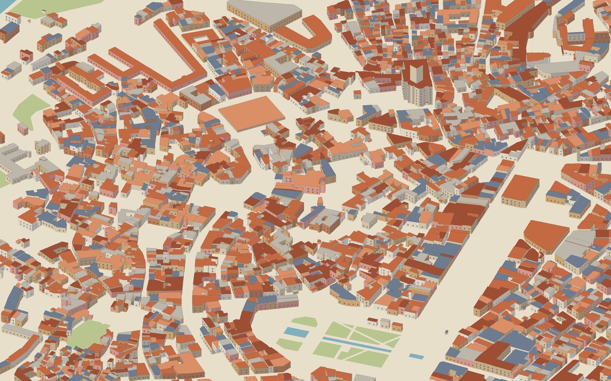
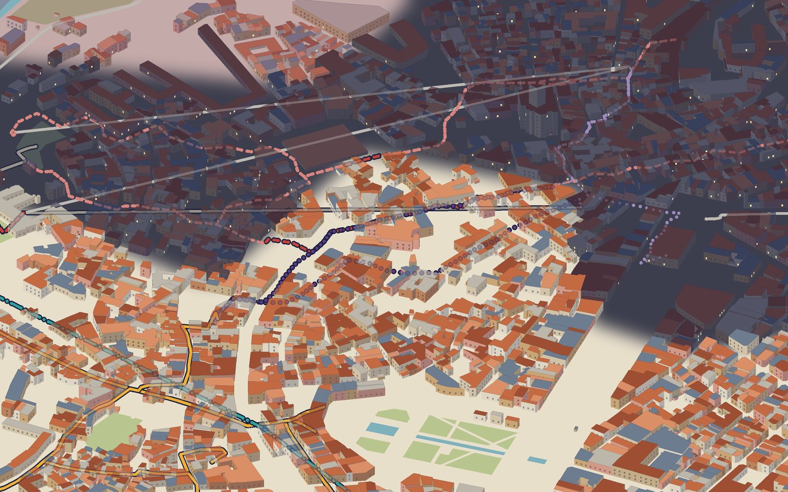
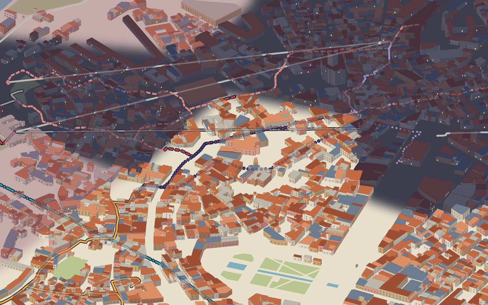
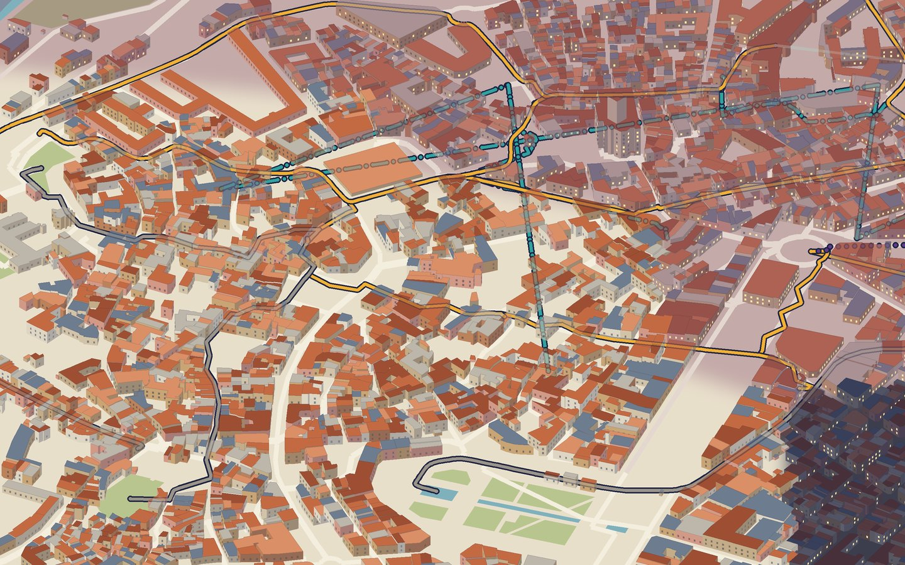
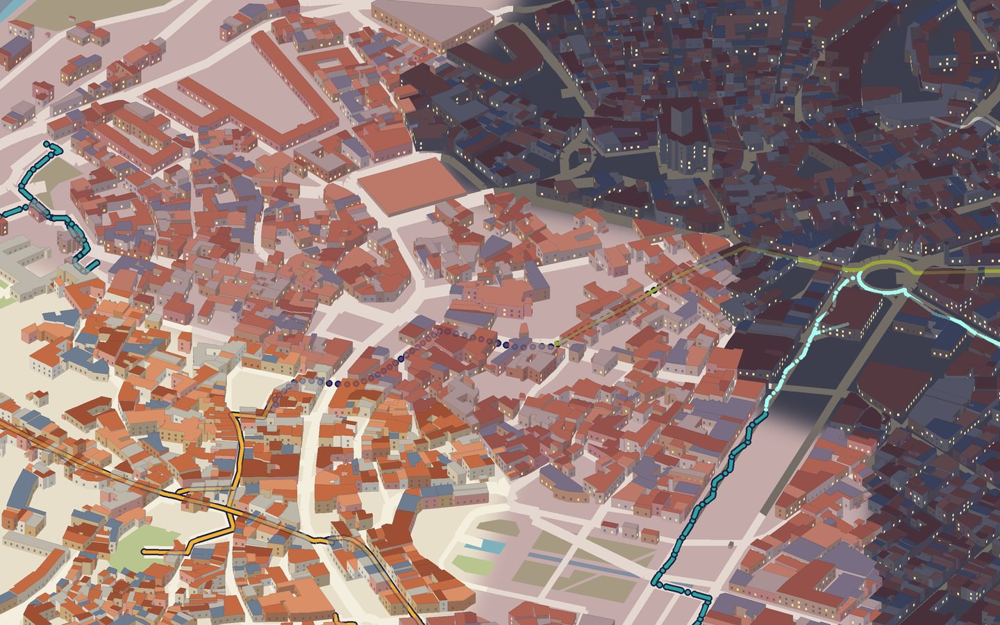
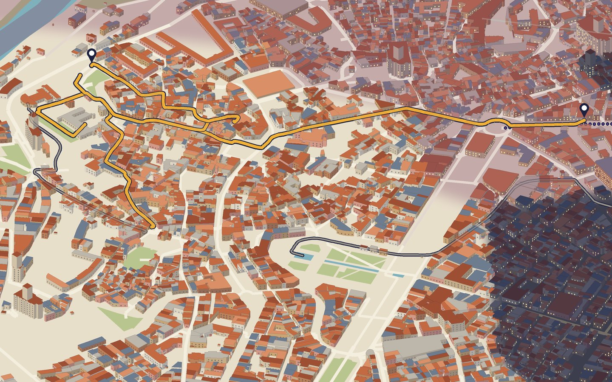
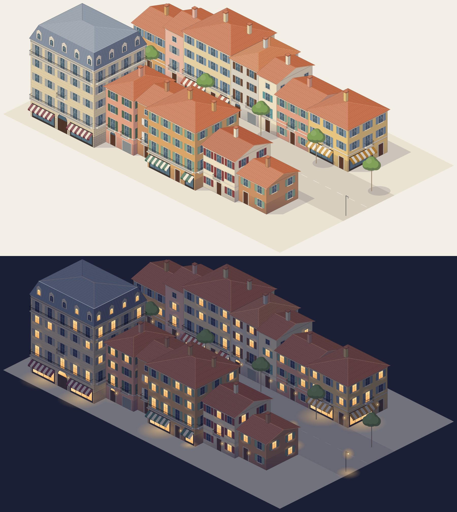
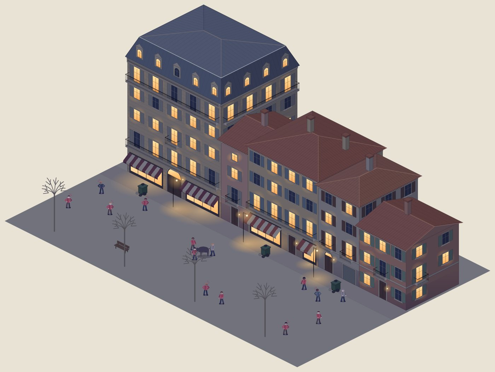
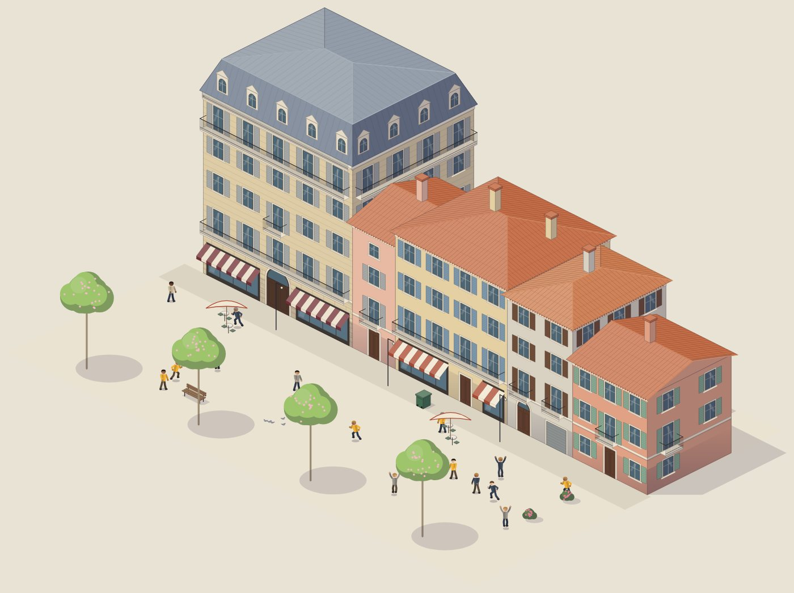
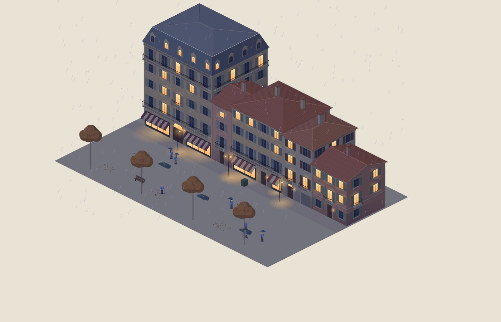

# Bible DA : balade béziers

Binôme 2 (noeud-b) : Maxens Sevilla et Rahim Tamhaev.

**Version 0.1, brouillon du 25/11/2026.** Rendu : vendredi 27/11, 17h, PDF. **[À FOURNIR]** : image ou contenu attendu. **[À CONFIRMER]** : choix à valider à deux. Fond de carte : © les contributeurs OpenStreetMap (ODbL).

**En une phrase.** Chaque message devient une balade dans Béziers, et toutes les balades, ensemble, dessinent le Béziers que les gens ressentent.

## 1. Intention

**Ce que l'œuvre doit faire ressentir.**

| Moment | Sensation | Comment |
| --- | --- | --- |
| On écrit | La confiance, puis le poids des mots | Une question simple, un avertissement clair : ce message ne s'effacera pas |
| On attend | La curiosité | Une ville se construit, étape par étape |
| On découvre sa balade | « C'est la mienne » | Un signe unique, un chemin dans de vraies rues |
| On regarde la ville | D'être un parmi d'autres | Des quartiers s'allument, s'éteignent, s'usent sous les pas |
| On revient | L'attachement | La ville a changé, sa balade est toujours là |

**Notre regard sur la chaîne.** Une blockchain garde des paroles qu'on n'efface pas ; une ville garde les pas de ceux qui la traversent. Un *bloc* de la chaîne est un *bloc* de maisons. Les messages des trois binômes passent dans la même ville, sous les mêmes règles.

**Pourquoi Béziers.** C'est notre lieu. Les rues, les bâtiments et les repères sont vrais : le visiteur peut reconnaître son quartier, ce qui rend l'abstrait (une émotion lue par une IA) très concret. Piste donnée par l'enseignante d'art, choisie par nous deux ; balade individuelle puis carte commune approuvées par les enseignants.

**Ce que nous refusons.** Juger le visiteur, le suivre, donner une adresse, se moquer d'un lieu de culte ou de mémoire, et une œuvre qu'on ne peut pas lire sans voir les couleurs.

**Écarté.** Une planche de BD, une galaxie, un visage, une forêt, des flèches, une ville de nuit générique : testés en esquisses. Béziers l'emporte parce que la donnée y a déjà une place, la rue.

## 2. Moodboard

Nous regardons des **systèmes** : pour chaque référence, comment l'image est fabriquée, avant ce qu'elle montre.

| Référence | Comment l'image est fabriquée | Ce que nous retenons | Ce que nous ne prenons pas |
| --- | --- | --- | --- |
| Vera Molnár (cours) | Quelques éléments simples, des règles et des pourcentages de hasard | Peu de règles, beaucoup de résultats | Le hasard pur : chez nous, la donnée décide |
| Visit Nordkyn, Neue (cours) | Une forme fixe, que le vent et la température changent | Idée, système, zones, puis la donnée : notre planche du signe | Sa forme hexagonale |
| MIT Media Lab, TheGreenEyl (cours) | Trois formes dans une grille de 4 × 4 invisible, 12 combinaisons de couleurs, environ 40 000 logos par combinaison | Une grille fixe, un signe par personne | Ses formes |
| Jardin virtuel de Qubo Gas (cours) | Un jardin qui change selon la météo, en temps réel | Une donnée extérieure change un paysage familier | Le temps réel météo |
| Strava | Des parcours superposés : plus on passe, plus le chemin se voit | Les rues qui s'usent sous les balades | Le suivi des personnes : nous n'utilisons aucune position |
| Plan de métro | Une géographie simplifiée en lignes, couleurs et étapes | Étapes, lignes, lecture rapide | L'abstraction : nos rues restent vraies |
| Monopoly | Un plateau où un lieu a une couleur et une pièce posée dessus | Les familles de lieux, les repères en volume | Son dessin et son argent |
| Google Maps | Le zoom révèle des détails, niveau par niveau | Trois niveaux : ville, quartier, lieu | L'aspect, la recherche, les données personnelles |

**[À FOURNIR]** Images et sources, par withRen. Chaque image sera légendée avec son auteur, sa date et son adresse. Nous nous en inspirons sans reprendre de dessin.

## 3. Ambiance colorée

**L'idée.** La ville est la **matière**, calme ; l'émotion est la **lumière** posée dessus. Palette **fermée**, environ 200 teintes, détaillée dans [palette.md](palette.md).

| Groupe | Teintes | Donnée qui choisit | Usage |
| --- | --- | --- | --- |
| Matières de Béziers | Enduits, tuiles, zinc, volets, végétation, eau : 30 de jour | `valence` du quartier, en trois lumières | Bâtiments, sol, eau |
| Émotions | 7 teintes × 5 crans | `emotion`, `intensite` | Tracé, halo |
| Familles de lieux | 10 familles × 3 tons | `lieu` | Symbole, liseré |
| Ambiances | 9 × 2 tons | `ambiance` | Voile autour d'un parcours |
| Interface | Encre, papier, gris | Aucune | Panneaux, boutons |

| joie | tristesse | colere | peur | surprise | degout | neutre |
| --- | --- | --- | --- | --- | --- | --- |
| #F2B134 | #4F6FA8 | #C8413A | #5E3C8A | #2FA3A0 | #9AA53A | #9A948A |
| trait plein, épais | longs tirets | tirets courts | points | tiret et point | double trait | trait plein, fin |

**Elle tient à 3 comme à 300.** Les teintes de la ville sont nombreuses mais proches et calmes ; les sept émotions ne colorent que les tracés. Sur la carte commune, un seul tracé est fort à la fois.

**Chaque choix.**

- Les couleurs de la ville sont observées à Béziers et reprises des bâtiments dessinés.
- Sept émotions testées par calcul : écart d'au moins 5 dans trois daltonismes simulés (crans 0,5 à 1), et au moins 10 la nuit.
- Le motif double la couleur : on lit l'émotion sans la couleur.
- Un liseré encre garde le tracé lisible le jour et au crépuscule (contraste 10 et 6,4).

**[À CONFIRMER]** Peur et dégoût plus contrastés, eau et savoir échangées, à voir sur les assets.

## 4. Typographie

| Famille | Rôle | Pourquoi |
| --- | --- | --- |
| Bricolage Grotesque | Titres (64, 36, 24) | Une enseigne de rue : ronde, un peu irrégulière |
| Atkinson Hyperlegible Next | Textes et interface (18, 15) | Dessinée pour les lecteurs malvoyants |
| JetBrains Mono | Empreintes (15) | Chasse fixe : on compare caractère par caractère |

**Lisible ou texture ?** Lisible, toujours. Le message se lit dans un panneau, en 18 px. Sur la carte, **aucun mot** : la ville, les symboles et les tracés parlent. Nous avons écarté le texte comme texture, car un message mérite d'être lu, et parce que notre esquisse de flèches avec des mots devenait illisible à 300.

Jamais moins de 15 px. Contraste AA au moins. **[À CONFIRMER]** les trois familles.

## 5. Symbole

| | Emblème | Signe |
| --- | --- | --- |
| Forme | La colline de Béziers, le clocher de Saint-Nazaire, une balade autour | Un pâté de maisons de 4 × 4 traversé par une balade |
| Change | Jamais | À chaque message |
| Où | Onglet, en-tête, accueil, documents | Fin de l'attente, carte de balade, liste |

**L'emblème** vient d'une idée de withRen, simplifiée : une seule couleur, une signature verticale et horizontale, inverse, sur papier, sur la nuit, et un favicon (le clocher et un arc) lisible à 16 px.

**Le signe** répond à un système fixe que la donnée déforme :

| Fixe | Change |
| --- | --- |
| Grille de 4 × 4, entrée à gauche, sortie à droite, maisons basses devant | Le nombre de virages (`tension`), la hauteur (`energie`), une maison qui quitte le sol (`absurdite`), la couleur de la rue (`emotion`), la lumière (`valence`), le détail des maisons (`id`) |

Le même message redonne toujours le même signe. Planches : [emblème](https://www.figma.com/design/ryY2ksOgkdLQXyIwtDPPKw/Sans-titre?node-id=39-128) et [construction](https://www.figma.com/design/ryY2ksOgkdLQXyIwtDPPKw/Sans-titre?node-id=33-91). Détails : [identite.md](identite.md).

## 6. Règles génératives

### Du message à la balade

| Donnée | Plage | Règle |
| --- | --- | --- |
| `lieu`, `lieu_secondaire` | 10 familles | Familles des étapes ; le vrai lieu vient de l'`id` |
| `energie` | 0 à 1 | 2 à 6 étapes |
| `emotion` | 7 | Couleur et motif du tracé |
| `intensite` | 5 crans | Force de la couleur |
| `tension` | 5 crans | Tracé souple à zigzag serré, sans quitter la rue |
| `absurdite` | 0 à 1 | À partir de 0,5 un tronçon, de 0,75 tous : la balade coupe à travers la ville |
| `ambiance` | 9 | Voile et motif autour du parcours |
| `id` | Empreinte SHA-256 | Choisit les lieux et les détails, toujours pareil |

Les chemins suivent les vraies rues d'OpenStreetMap. Un zigzag reste dans la rue : c'est la tension. Quitter la rue, c'est l'absurdité.

### De la balade à la ville

Un quartier regarde ses **20 derniers messages**, quel que soit le binôme.

| Donnée du quartier | Plage | Règle |
| --- | --- | --- |
| Moyenne de `valence` | 0,12 ou plus | Jour |
| | Entre -0,12 et 0,12 | Crépuscule (jour et nuit superposés) |
| | -0,12 ou moins | Nuit |
| | Aucun message | Jour |
| Nombre de messages | | Fenêtres allumées la nuit et au crépuscule |
| Passages dans une rue | | La rue s'use : chemin plus clair, plus large |
| Message masqué | | Sa balade et ses effets disparaissent, un volet fermé reste **[À CONFIRMER]** |

**Ce qu'un nouveau texte déplace.** Il ajoute sa balade, use les rues qu'il emprunte, allume des fenêtres, et peut **faire passer un quartier du jour à la nuit**. La moyenne tend vers zéro quand les messages sont nombreux : les seuils à 0,12 viennent d'un essai, avec 0,25 tout restait au crépuscule. **[À CONFIRMER]**

**Beaucoup de balades.** De loin, 4 balades récentes par quartier ; au zoom, 12. Les plus anciennes usent la rue. Celle qu'on choisit est seule épaisse, avec halo et épingles. Testé et rejeté : le ruban de couleurs au sol.

**Trois niveaux de zoom.** Ville : blocs simples. Quartier : bâtiments génériques et repères. Lieu : fenêtres, arbres, passants, mobilier.

### Garde-fous

Aucun clignotement rapide ; mouvement coupé si on le demande ; le jour peut être forcé partout ; lieux de culte, cimetières et mémoires sans humour ; religions non distinguées ; aucune adresse ; silhouettes sans visage. Détails : [ville-vivante.md](ville-vivante.md).

## 7. Esquisses

Vraies rues et vrais bâtiments, palette v3. Les blocs sont provisoires : de près, les bâtiments de withRen les remplacent. Messages inventés, émotions choisies par quartier pour montrer les trois lumières.

| Vide | 10 messages |
| --- | --- |
|  |  |
| Un texte masqué | 60 messages |
|  |  |
| 300 messages | Une balade choisie |
|  |  |

**De près** : bâtiments, passants et mobilier dessinés par withRen, jour et nuit.

| Colère | Joie | Tristesse |
| --- | --- | --- |
|  |  |  |

**[À FOURNIR]** Vue au zoom sur une vraie rue avec plusieurs balades, jour et nuit, par withRen. Les trois quartiers voisins de son test.

## 8. Design system

Interface calme, sur papier clair, pour laisser parler la ville. Principes : contraste AA, cible de 48 px, focus bleu visible, **jamais la couleur seule**.

| Composant | Ce qu'il fait |
| --- | --- |
| Bouton | Principal et secondaire ; repos, focus, inactif |
| Champ message | Vide, focus, erreur ; compteur de points de code |
| Statut | En attente, dans un bloc, lue par l'IA, stable, masquée : un signe et un mot |
| Carte balade | Titre, émotion écrite et motif, message, étapes, distance, empreinte |
| Avertissement et aide | Non effaçable, partagé, IA ; 3114, 15, 112 |
| Légende, quartier | Couleur, motif et mot ; l'humeur est toujours écrite |
| Interrupteur, zoom | Toujours voir de jour ; boutons de 48 px |

**Les écrans** (brouillon, [Figma](https://www.figma.com/design/ryY2ksOgkdLQXyIwtDPPKw/Sans-titre?node-id=44-2)) : écrire, attendre (la ville se construit en quatre étapes : terrain, chantier, façades, habitants), découvrir sa balade, explorer, et un refus sur téléphone. **[À FOURNIR]** captures pour le PDF.

**Liste accessible.** Une liste des balades, au clavier et au lecteur d'écran, double la carte : titre, émotion, étapes, distance.

## À faire avant le rendu

| Quoi | Qui |
| --- | --- |
| Moodboard illustré et sourcé | withRen |
| Vue au zoom sur une vraie rue | withRen |
| Choisir : emblème, polices, seuil 0,12, peur et dégoût | les deux |
| Captures Figma, PDF, relecture | MaxX-J |
