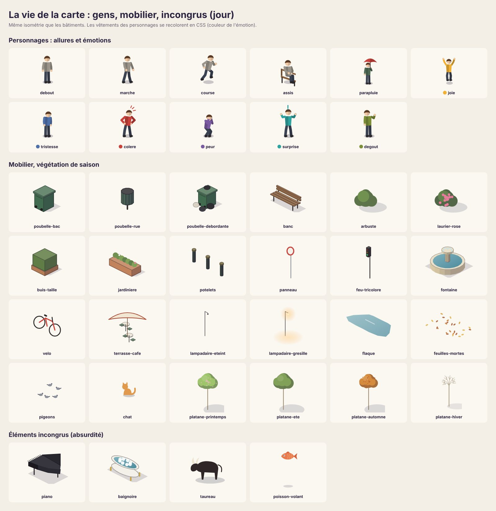
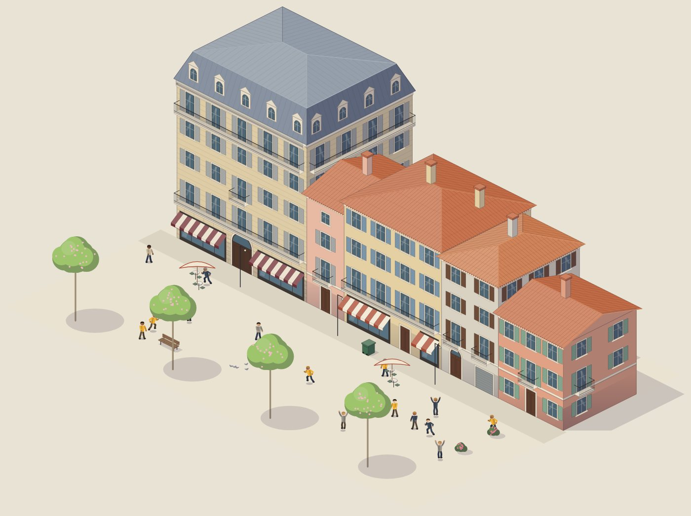
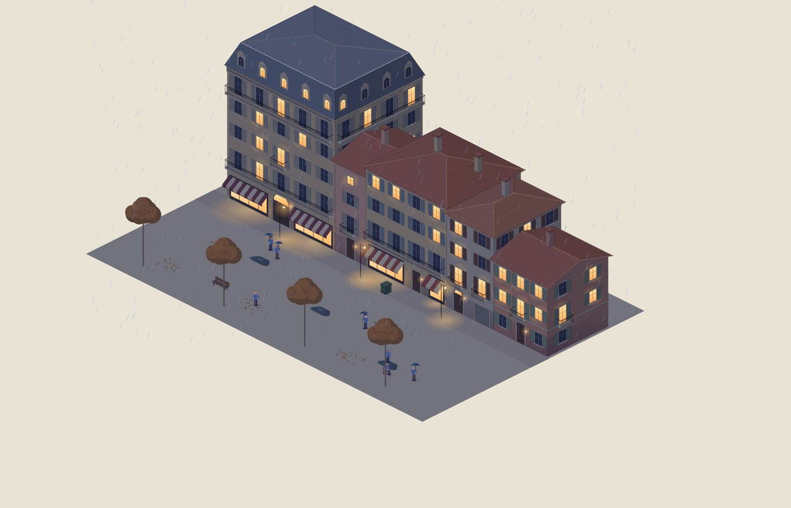
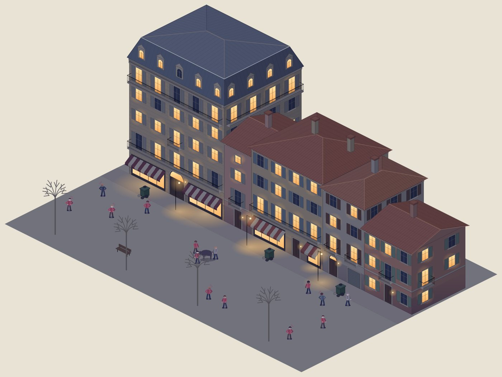

# Bâtiments de Béziers en relief (rendu B)

**BROUILLON du 25/11/2026**, à valider par MaxX-J et withRen. Pour le rendu B : la carte reste plate et les repères passent en relief 2,5D.

| Jour | Nuit |
| --- | --- |
|  |  |

Une rue composée uniquement d'assets génériques, pour montrer qu'ils s'assemblent :


Les trois teintes de chaque générique : [planche-variantes.jpg](apercu/planche-variantes.jpg).

## Ce qu'il y a

| Dossier | Contenu | Fichiers |
| --- | --- | --- |
| `reperes/` | 10 repères dessinés sur mesure | 20 (jour + nuit) |
| `generiques/` | 10 types de bâtiments × 3 teintes | 60 (jour + nuit) |
| `vegetation/` | platane, cyprès, palmier, olivier, pin parasol, lampadaire | 12 |
| `vie/personnages/` | 11 poses de passants : 5 allures + 6 émotions | 22 |
| `vie/mobilier/` | poubelles, bancs, arbustes, potelets, feux, fontaine, vélo, terrasse, lampadaires éteint et grésillant, platane des 4 saisons, flaque, feuilles, pigeons, chat | 48 |
| `vie/incongrus/` | piano, baignoire, taureau, poisson volant | 8 |
| `manifest.json` | la liste de tous les assets, leur emprise en mètres et leurs couleurs | |

**Repères :** cathédrale Saint-Nazaire, hôtel de ville, Polygone, gare, Cimetière Vieux, arènes, halles, Pont-Vieux, écluses de Fonseranes, allées Paul-Riquet.

**Génériques :** maison de ville R+2 et R+3, maison étroite, immeuble à commerces, immeuble bourgeois XIXe (toit à la Mansart), maison d'angle, maison de faubourg, maison de maître avec jardin, résidence des années 60-70, chai viticole.

## Règles communes à tous les fichiers

- **Isométrie 2:1** : 1 m au sol = 10 px. Un point du monde `(x, y, z)` en mètres se place à l'écran en `px = (x − y) × 10`, `py = (x + y) × 5 − z × 11,2`.
- **Ancre** : le point `(0, 0)` du `viewBox` est le centre de l'emprise au sol. Pour poser un asset sur la carte, on place ce point sur la position projetée du bâtiment.
- **Lumière** : elle vient de la gauche. Face gauche éclairée, face droite à l'ombre, ombre portée vers la droite.
- **Jour / nuit** : chaque asset existe en deux versions. La nuit, les murs passent au bleu nuit, certaines fenêtres s'allument (au hasard, mais toujours les mêmes) et les vitrines, lampadaires et portes éclairent le sol.
- **Ordre d'affichage** : dessiner d'abord ce qui est loin, c'est-à-dire trier par `x + y` croissant (le coin avant de l'emprise).
- Fond transparent, aucun texte, aucune marque ni logo.

## La vie de la carte (brouillon du 25/11)



Trois rues de démonstration, générées par `outil/scenes.py` à partir de valeurs :

| Joie, énergie forte, printemps | Tristesse, énergie faible, pluie, nuit | Colère, tension forte, hiver, absurdité |
| --- | --- | --- |
|  |  |  |

**Personnages.** Ils mesurent environ 1,8 m (20 px). Leurs couleurs sont des variables CSS, avec une valeur par défaut : `--haut`, `--bas`, `--peau`, `--cheveux`, `--objet`. Pour les changer, il faut insérer le SVG dans la page (ou passer par `<use>`) : une balise `` affiche toujours les couleurs par défaut. Les couleurs des émotions sont dans `manifest.json` (`couleurs_emotions`).

**Lampadaire grésillant.** Il clignote tout seul grâce à une petite animation CSS dans le SVG.

### Proposition : quelle valeur change quoi

C'est une **proposition de Claude, à valider à deux**. Elle n'utilise que les six valeurs validées le 23/11, et un réglage reste lisible seul.

| Valeur | Ce qui change dans la balade |
| --- | --- |
| `emotion` | La pose des passants et la couleur de leurs vêtements (une partie des passants seulement, pour rester naturel) |
| `energie` | Le nombre de passants (de 3 à 19 sur une rue) et leur allure : assis, debout, marche, course |
| `valence` | La météo et la saison du platane : printemps ou été si positive, automne si négative, hiver et pluie (flaques, parapluies) si très négative. Terrasses et lauriers fleuris si positive |
| `tension` | L'éclairage : à partir de 0,5 des lampadaires éteints et des poubelles qui débordent, à partir de 0,75 des lampadaires qui grésillent |
| `absurdite` | Un élément incongru, rare : à partir de 0,75 seulement, un seul par balade |
| `theme` | Le mobilier dominant : `nature` plus d'arbustes, `societe` plus de passants et de bancs, `quotidien` poubelles et vélos, `relation` passants par deux, `imaginaire` autorise l'incongru dès 0,5 |
| *(hors valeurs)* | Jour ou nuit selon l'heure du message dans la chaîne |

Avis : rendre la carte vivante est une bonne idée, à une condition : chaque valeur ne pilote qu'**un seul** aspect visible, sinon on ne sait plus lire la carte. Les éléments incongrus doivent rester rares pour garder leur effet.

## Optimisation

Les SVG sont allégés par `outil/opti.py` (traits fusionnés en chemins, nombres et couleurs raccourcis, dégradés inutiles retirés). Le rendu est identique et le poids baisse d'environ 60 % : les génériques passent de 5,8 Mo à 2,3 Mo, les repères de 2,4 Mo à 1,2 Mo. Un passant pèse environ 3 Ko.

## Ce qui est fidèle, et ce qui ne l'est pas

Observé sur des photos (Google Images), la vue satellite de Google Maps et les fiches patrimoine, le 25/11 :

- **Ville :** enduits ocre, sable, rose saumon et crème ; volets persiennés bleu-gris, verts ou lavande ; toits en tuiles canal orangées et peu pentus ; génoises sous les toits ; immeubles XIXe en pierre de taille avec toits en zinc gris-bleu, lucarnes et balcons en fer.
- **Cathédrale :** façade fortifiée entre deux tours crénelées, grande rosace, portail ogival sous un gâble, mâchicoulis, clocher carré crénelé avec tourelles d'angle et campanile en fer. Les proportions sont simplifiées et le clocher est déplacé pour rester visible.
- **Hôtel de ville :** pierre de taille, avant-corps central, tour avec blason, horloge, balustrade à pots à feu et campanile en fer forgé. Le nombre de travées et le toit sont supposés.
- **Polygone :** gradins blancs, rue à ciel ouvert sous une pergola blanche et vitrée, rotonde avec un grand écran. L'écran est un dégradé sans texte.
- **Gare :** long bâtiment en pierre ocre clair, baies cintrées, pavillon central plus haut avec fronton et horloge, marquise sur les voies.
- **Arènes :** mur de brique à deux rangs d'arcades, pavillon d'entrée à bandes brique et pierre surmonté d'une tourelle.
- **Halles :** structure Baltard en fer, persiennes claires, soubassement en brique, lanterneau, portail en pierre.
- **Cimetière Vieux :** enclos, portail cintré à fronton, tombes blanches, chapelles, beaucoup de cyprès.
- **Inventé ou simplifié :** les mesures exactes, le nombre de baies, l'arrière des bâtiments, les arènes plus petites que les vraies, le kiosque et la statue des allées, le Pont-Vieux dessiné seul (sans la cathédrale au-dessus).

## Comment ils ont été faits

Les SVG sont produits par un petit script de dessin en Python, dans [`outil/`](outil). Ce n'est pas du code de l'application : il sert seulement à dessiner les assets. Il permet de changer une teinte, une hauteur ou l'éclairage, puis de tout régénérer :

```sh
cd docs/bible-da/assets/batiments/outil
python3 construire.py ..   # SVG + manifest.json
python3 planche.py ..      # pages HTML des planches (dont planche-vie)
```

- `iso.py` : projection, lumière, couleurs jour/nuit, murs, toits, fenêtres, arbres.
- `generiques.py` : les bâtiments génériques et leurs teintes.
- `reperes.py` : les repères, un par fonction.
- `vie.py` : passants, mobilier, saisons et incongrus.
- `scenes.py` : assemble une rue à partir de valeurs (pour les démonstrations).
- `opti.py` : allège les SVG.

## Questions ouvertes

1. Le style vous va-t-il (niveau de détail, jour / nuit) ?
2. Faut-il un repère de plus (théâtre, Plateau des Poètes, stade, pont-canal de l'Orb, église de la Madeleine) ?
3. La nuit correspond-elle à une valeur (par exemple `valence` ou l'heure du message) ou à un réglage d'affichage ?
4. Les fenêtres allumées la nuit pourraient compter les messages d'un quartier.
5. Le tableau « quelle valeur change quoi » vous convient-il ?
