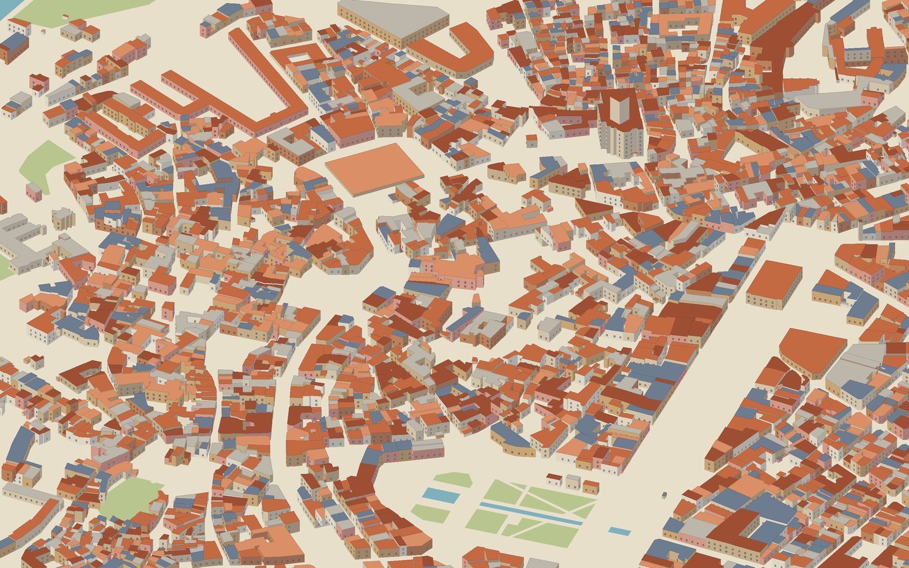
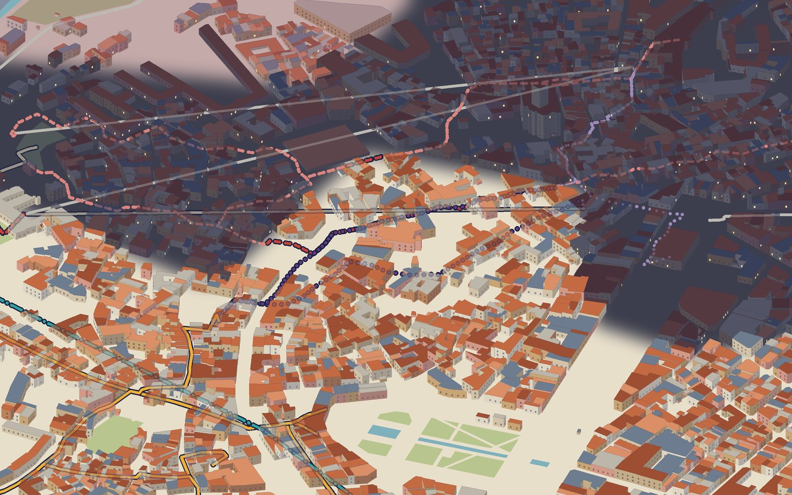
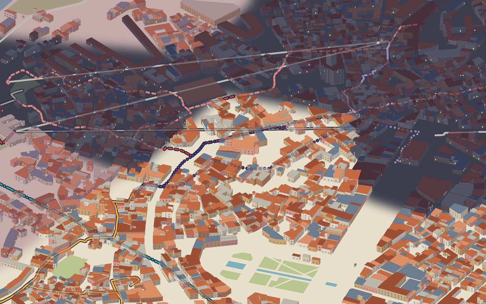
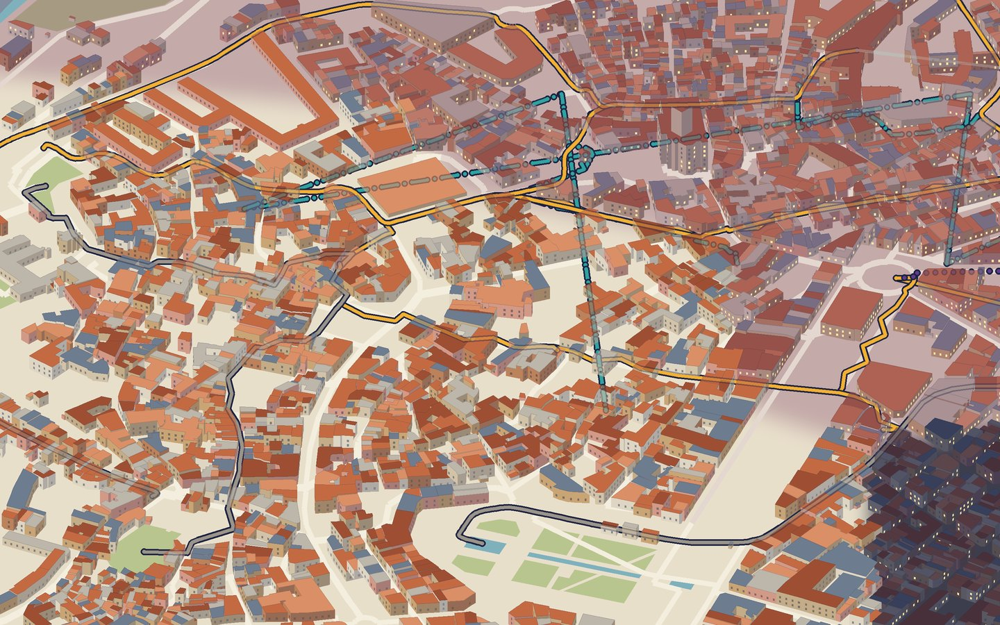
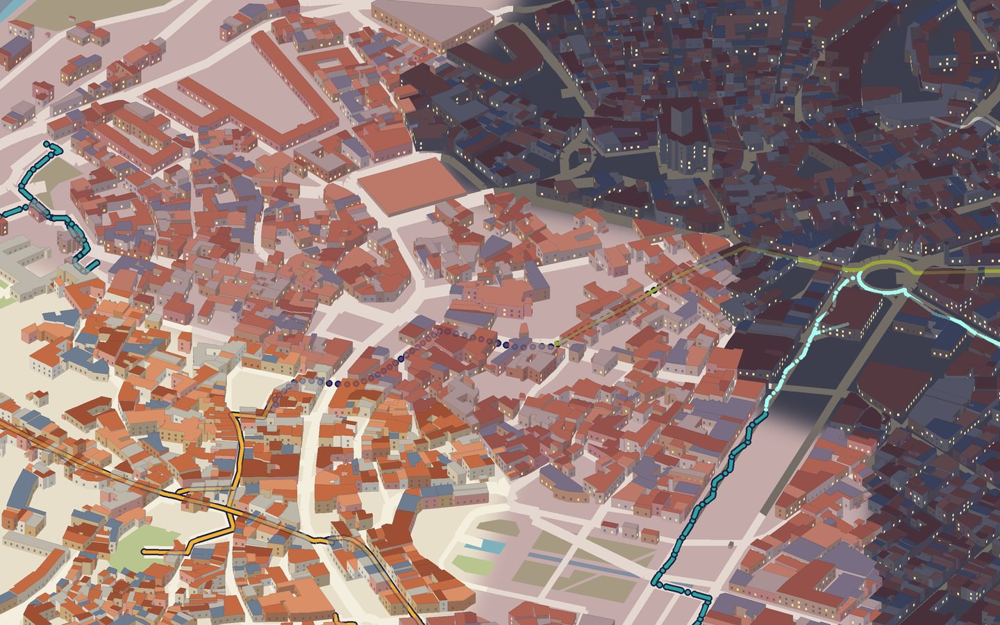
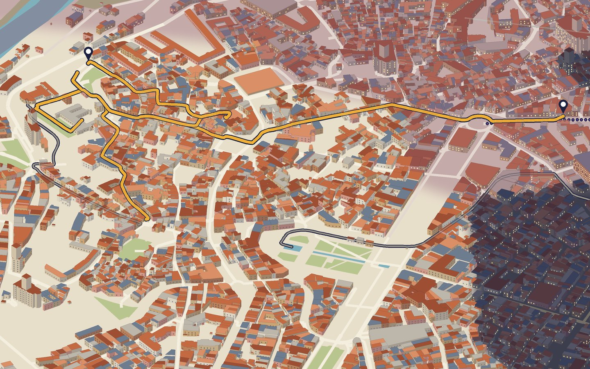

# Esquisses en rendu C

**BROUILLON du 25/11/2026.** Vraies rues et vrais bâtiments de Béziers, palette v3, lumière par quartier. © les contributeurs OpenStreetMap, ODbL. Messages inventés, émotions choisies pour l'essai, quartiers approximatifs, hauteurs en partie estimées. Les bâtiments sont des blocs : les assets de withRen n'y sont pas encore.

| Vide | 10 messages |
| --- | --- |
|  |  |
| 10, un masqué | 60 messages |
|  |  |
| 300 messages | Une balade choisie |
|  |  |

## Ce que l'essai montre

- **Le ruban est abandonné.** Les balades anciennes usent la rue : un chemin clair d'une seule teinte, plus large avec les passages.
- **Les seuils de lumière étaient trop larges.** Avec plus ou moins 0,25, presque toute la ville restait au crépuscule, car les moyennes se rapprochent de 0. Essai avec **plus ou moins 0,12** et la ville vide de jour : les trois lumières apparaissent.
- Les messages absurdes, en ligne droite, traversent bien la ville.
- À revoir : les fenêtres sont trop petites de loin, certaines balades passent derrière les bâtiments.
