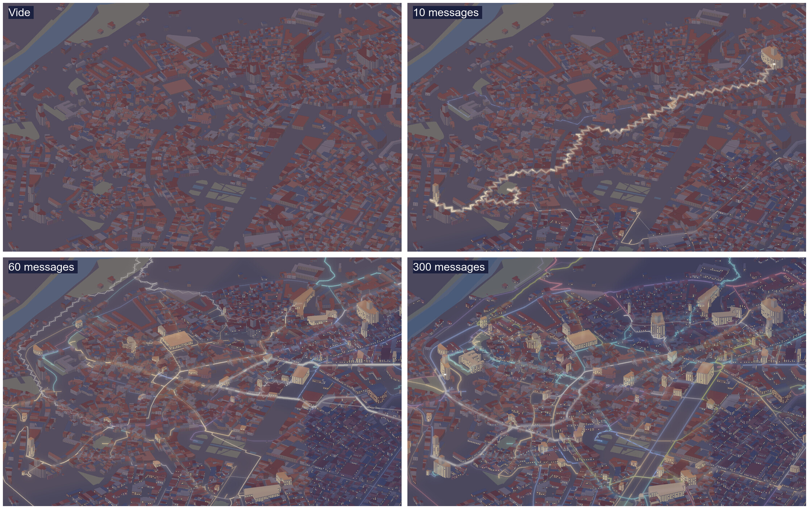

# Essai : une seule chaîne

**Essai du 25/11/2026. Chaîne unique choisie par MaxX-J le 26/11, à valider par withRen.** Idée de MaxX-J : chaque balade part d'où la précédente s'est arrêtée, comme un bloc suit le précédent. © les contributeurs OpenStreetMap, ODbL. Messages et émotions inventés.

## De loin

## Au zoom

## Règles essayées

| Quoi | Règle |
| --- | --- |
| Couleur d'une rue | Émotion du dernier passage |
| Force de la lumière | Nombre de passages, en se tassant |
| Dernières balades | Un trait qui s'estompe ; la dernière est la plus forte, avec un point |
| Message masqué | Son bout de trait devient gris, la chaîne n'est pas coupée |
| `valence` | Quartier plus chaud ou plus froid, ville toujours au crépuscule (**remplacerait jour et nuit**) |

## Les bâtiments visités grandissent

Idée de MaxX-J. La lumière dit par où on passe, la hauteur dit où on s'arrête.

| Quoi | Règle essayée |
| --- | --- |
| Visite | Une étape de balade, pas un passage dans la rue |
| Bâtiment simple | Plus haut, jamais plus large, vite puis plafonné (jusqu'à environ 2,6 fois, plus 6 m) ; teinte chaude, fenêtres allumées |
| Repère | Jusqu'à 1,7 fois |
| Cimetière, nature, eau | Ne grandissent pas |
| Message masqué | Sa visite ne compte plus |
| `tension` | Trait souple à dents serrées, grossi de loin : **il sort encore un peu des rues** |
| `intensite` | Force de la couleur du trait |

Pas dessiné : `ambiance`. Les étages des assets de withRen restent à prévoir.

## Choix du 26/11 (MaxX-J)

1. Chaîne unique : gardée.
2. Jour, crépuscule et nuit : gardés, le crépuscule partout est abandonné.
3. Les bâtiments grandissent par **étages**, pas en étirant l'image.
4. Message masqué : un volet fermé, pas de bout gris.
5. `tension` reste dans la rue ; `absurdite` pose un objet incongru ; `ambiance` est retirée.

## À améliorer

La ville vide est terne, la tête se perd à 300, les couleurs de lumière ne sont pas encore celles de la palette, les assets de withRen ne sont pas placés. La longueur maximale d'un trajet et le trajet si l'IA échoue restent à fixer. L'ordre suit les blocs : on trace un message une fois dans un bloc.
