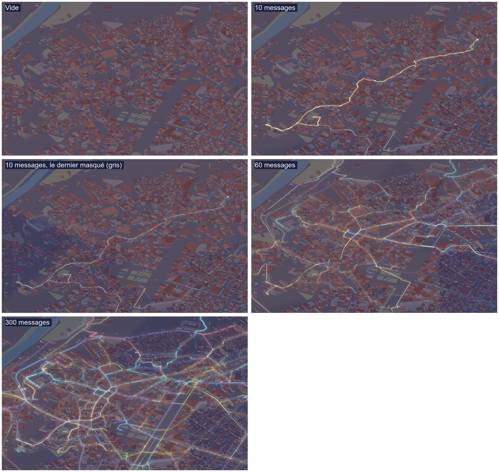
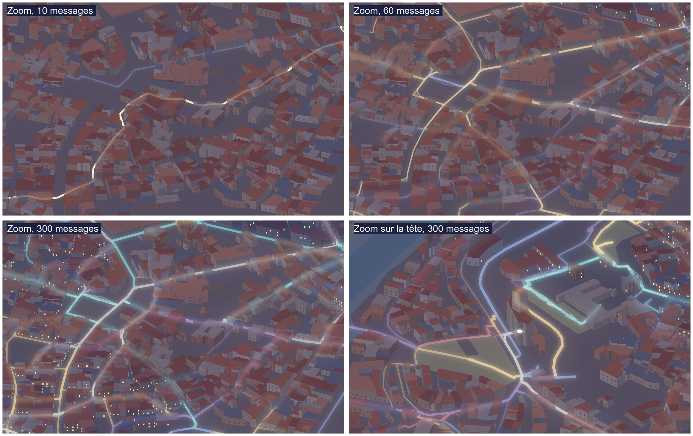

# Essai : une seule chaîne

**BROUILLON du 25/11/2026, pas décidé.** Idée de MaxX-J : chaque balade part d'où la précédente s'est arrêtée, comme un bloc suit le précédent. © les contributeurs OpenStreetMap, ODbL. Messages et émotions inventés.

## De loin

## Au zoom

## Règles essayées

| Quoi | Règle |
| --- | --- |
| Couleur d'une rue | Émotion du dernier passage |
| Force de la lumière | Nombre de passages, en se tassant |
| Dernières balades | Un trait qui s'estompe ; la dernière est la plus forte, avec un point |
| Message masqué | Son bout de trait devient gris, la chaîne n'est pas coupée |
| `valence` | Quartier plus chaud ou plus froid, ville toujours au crépuscule (**remplacerait jour et nuit**) |

## À trancher à deux

1. Garder cette idée de chaîne unique ?
2. Crépuscule partout, ou garder jour, crépuscule et nuit ?
3. Le sens de la teinte grise d'un message masqué.

## À améliorer

La ville vide est terne, la tête se perd à 300, les couleurs de lumière ne sont pas encore celles de la palette, les assets de withRen ne sont pas placés. La longueur maximale d'un trajet et le trajet si l'IA échoue restent à fixer. L'ordre suit les blocs : on trace un message une fois dans un bloc.
