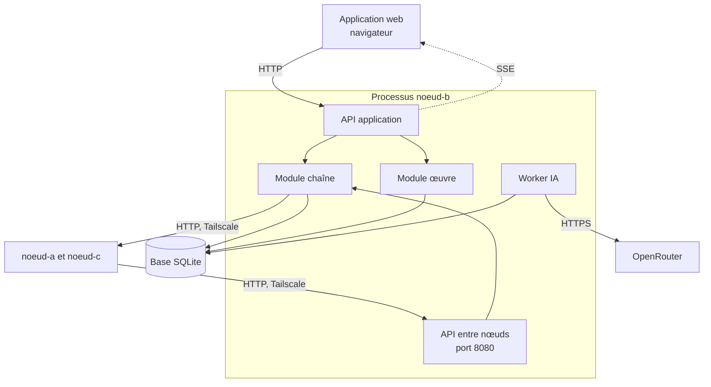

# Dossier de binôme 2 (noeud-b)

23/11/2026

Brouillon à relire par les deux avant le dépôt sur Moodle (vendredi 27/11, 17h). Ce dossier s'appuie sur la spec commune v1.0 sans la recopier : les numéros comme 4.2 ou 6.3 renvoient à ses sections. Deux repères marquent ce qui n'est pas figé. **\[DA\]** : dépend de la direction artistique, pas encore fixée. **\[À CONFIRMER\]** : proposition que le binôme doit valider.

| Champ | Valeur |
| --- | --- |
| Binôme | 2 : Maxens Sevilla (`MaxX-J`) et Rahim Tamhaev (`withRen`) |
| Nœud | noeud-b (producteur d'un créneau de 20 s sur trois, ordre a, b, c) |
| Spec commune | version 1.0 du 23/11/2026 |
| Version du dossier | 0.4, brouillon corrigé |
| Langage | TypeScript, pour le nœud et pour l'application |

## 1. Le projet en bref

**Notre regard.** Une blockchain est une suite de messages qu'on ne peut plus effacer. Nous en faisons une œuvre qui grandit avec la chaîne : chaque message y ajoute un élément, dont l'aspect vient de ce que l'IA a lu dans le texte. **\[DA\]** La forme visuelle n'est pas encore choisie.

**Ce que permet l'application.** Le visiteur lit la consigne d'écriture, écrit un message de 280 caractères au plus, puis voit son élément apparaître dans l'œuvre. L'élément est d'abord en attente, puis dessiné quand le message est entré dans un bloc et que l'IA l'a lu. Le visiteur peut parcourir toute l'œuvre. Avant d'écrire, il est prévenu que son message ne s'effacera pas, sera partagé avec les deux autres binômes et envoyé à une IA, et ne doit contenir aucune donnée personnelle (spec 8.1).

**Ce que montre l'œuvre.** L'IA lit chaque message et en tire six valeurs (provisoires, en cours de test) : `valence`, `energie`, `tension`, `absurdite`, `emotion` et `theme`. Elles décrivent le message, pas le dessin : elles restent valables quelle que soit la direction artistique. Les définitions sont dans la charte éditoriale. Les trois binômes lisent les mêmes messages, mais notre œuvre ne ressemble pas à celles des deux autres.

**Ce qui est indispensable.**

- Écrire un message et le voir arriver dans la chaîne.
- Voir l'œuvre se construire, élément par élément.
- Un nœud complet, qui passe les cas de test de la spec (section 10).
- Garder la trace du modèle d'IA qui a réellement répondu.

**Ce qui est en plus, si le temps le permet.** Un panneau sur l'état de la chaîne, l'export de l'œuvre en image, une animation d'apparition. Le détail est dans le backlog, rendu à part.

## 2. L'architecture

Les flèches montrent qui appelle qui. Tout ce qui est dans le cadre tourne dans un seul processus Node.js sur l'ordinateur du binôme. Le module chaîne est le centre : rien n'entre dans la chaîne sans passer par lui.

| Composant | Rôle | Où il tourne | Comment il parle aux autres |
| --- | --- | --- | --- |
| Application web | Écrire un message, parcourir l'œuvre, dessiner les éléments en SVG | Navigateur du visiteur, fichiers servis par le nœud. Ouverte sur l'ordinateur du nœud et sur les machines du réseau Tailscale. | HTTP et flux d'événements SSE vers l'API de l'application |
| API application | Recevoir et filtrer les messages (charte, limite de 5 par visiteur et par 10 s), fournir l'œuvre, prévenir l'application | Processus noeud-b, port propre à l'application, distinct du 8080 et joignable par le réseau Tailscale seulement. | Appelle le module chaîne pour écrire, lit le module œuvre |
| Module chaîne | Texte canonique, id, signature, validation, file d'attente, production de blocs à notre créneau, rattrapage | Processus noeud-b | Lit et écrit la base. Envoie aux pairs et les interroge par un client HTTP (POST /messages, POST /blocks, GET /status). |
| API entre nœuds | Les cinq routes de la spec (6.3), les limites de débit (8.2) | Processus noeud-b, port 8080, joignable par le nom Tailscale noeud-b | HTTP et JSON avec noeud-a et noeud-c. Chaque objet reçu passe par le module chaîne. |
| Worker IA | Lire les messages de la chaîne sans résultat, appeler l'IA, enregistrer valeurs et statut | Processus noeud-b, tâche de fond | Lit la base, appelle OpenRouter, écrit dans ai\_results |
| Module œuvre | Ordonner les éléments, associer chaque élément à ses valeurs ou à des valeurs par défaut | Processus noeud-b | Lit blocks, messages et ai\_results. Fournit l'œuvre à l'API de l'application. |
| Base SQLite | Chaîne, file d'attente, résultats IA, créneaux signés, journaux | Fichier local sur l'ordinateur du nœud | Accès direct par les modules du processus, sans réseau |
| Pairs (noeud-a, noeud-c) | Les deux autres nœuds de la chaîne | Ordinateurs des binômes 1 et 3 | Tailscale, HTTP sur le port 8080 |
| OpenRouter | Fournit les modèles d'IA gratuits | Internet | HTTPS, port 443, ouvert sur eduroam |

## 3. Le parcours d'un message

Un message passe par neuf étapes, de la saisie à son élément dans l'œuvre. Les numéros de spec indiquent la règle suivie à chaque étape.

| N° | Composant | Ce qui se passe | Si ça échoue |
| --- | --- | --- | --- |
| 1 | Application | Le visiteur lit l'avertissement (message non effaçable, partagé, envoyé à une IA, sans donnée personnelle), écrit son texte et valide. | Erreur affichée sous le champ, saisie conservée. |
| 2 | API de l'application (dans le nœud) | Mise en forme NFC, contrôle de la longueur (1 à 280 points de code) et des caractères interdits, filtre de la charte éditoriale, limite de 5 messages par visiteur et par 10 s (spec 2.1, 8.1, 8.2). | Refus avant signature : le message n'a ni id ni trace. |
| 3 | Nœud, module chaîne | Horodatage strictement croissant, texte canonique, id (SHA-256), signature Ed25519, écriture dans la file d'attente en base (spec 2.1, 3.1). | Erreur interne : le message n'est pas créé, le visiteur peut réessayer. |
| 4 | Nœud, module réseau | Envoi immédiat aux deux pairs par POST /messages, délai de 3 s, pas de nouvelle tentative (spec 6.4.1). | Le sondage de 10 s des pairs rattrape l'envoi raté (spec 6.4.3). |
| 5 | Nœud, producteur | À notre créneau, si la file n'est pas vide : appel de GET /status sur les pairs. Il faut qu'au moins un pair réponde, qu'aucun n'annonce une chaîne strictement meilleure (hors têtes ignorées, spec 7), ne pas être en SYNCING, ne pas avoir produit le dernier bloc et ne pas avoir déjà signé dans ce créneau ou un plus récent. Prise de 50 messages au plus, bloc signé entre la 2e et la 15e seconde, ajouté à la chaîne, envoyé aux pairs (spec 4.2). | Pas de bloc, les messages attendent le créneau suivant. |
| 6 | Nœud, module chaîne | Un bloc reçu d'un pair est validé (spec 3.2), ajouté, et ses messages sortent de la file. Une fourche déclenche le rattrapage (spec 5, 7). | 409 ou 422 selon la spec, journalisé. |
| 7 | Nœud, worker IA | Pour chaque message de la chaîne sans résultat en base, appel à OpenRouter, contrôle du format, enregistrement de message\_id, block\_index, modèle demandé, modèle utilisé, valeurs, status et processed\_at (spec 9). | Statut timeout, invalid\_format ou refused, valeurs par défaut pour le dessin. |
| 8 | Nœud, module œuvre | Les messages sont ordonnés par index de bloc puis position dans le bloc, jamais par timestamp (spec 5.3). Chaque élément reçoit ses valeurs. | Élément provisoire dessiné avec des valeurs par défaut. |
| 9 | Application | Le nœud prévient l'application par un flux d'événements. L'élément apparaît, puis est marqué stable quelques blocs plus tard. | Si le flux se coupe, l'application se reconnecte et relit l'état. |

**Stabilité.** Un élément est marqué stable quand 3 blocs ont suivi le sien.

**Visiteur.** Pour la limite de 5 messages par 10 s, un visiteur est reconnu par un cookie de session anonyme. L'effacer contourne la limite : c'est accepté.

**Cas d'une fourche.** Si une autre chaîne est adoptée, les messages de nos blocs abandonnés retournent dans la file (spec 5.2). Leurs résultats IA restent en base, car la clé est l'id du message (spec 9) : l'IA ne les relit pas. L'œuvre est recalculée à partir de la nouvelle chaîne. Un élément peut changer de place ou disparaître provisoirement. « Stable » est un repère d'affichage, pas une garantie : la spec n'a pas de finalité (5.3).

## 4. Les données

La chaîne et la file d'attente sont stockées sur disque, comme la spec l'exige (section 7). Nous y ajoutons les résultats de l'IA, qui restent chez nous (spec 9). Tout vit dans une seule base SQLite, dans un fichier local, avec des transactions pour chaque écriture liée.

| Table | Rôle | Colonnes principales |
| --- | --- | --- |
| blocks | Les blocs de notre chaîne | block\_index (clé, champ `index` de la spec), hash, previous\_hash, timestamp, producer, messages\_hash, signature |
| messages | Les messages, qu'ils soient dans un bloc ou en attente | id (clé), node, timestamp, content, signature, block\_index (vide tant que le message est en file), position |
| ai\_results | Un résultat IA par message (spec 9) | message\_id (clé), block\_index, model\_requested, model\_used, ai\_values (JSON, champ `values` de la spec), status, processed\_at, et pour nous : attempts, prompt\_version, raw\_response |
| hidden\_messages | Les messages masqués dans l'œuvre, jamais retirés de la chaîne (spec 8.1) | message\_id (clé), reason, hidden\_at |
| slot\_log | Les créneaux déjà signés, écrits avant la signature (spec 4.2.3) | slot (clé), block\_hash |
| node\_state | Le dernier timestamp émis, pour qu'il reste croissant après redémarrage (spec 2.1) | key, value |
| events\_log | Erreurs, doubles signatures et écarts d'horloge servant de preuve (spec 3.4, 8.3) | id, at, kind, peer, detail (JSON : pour une double signature, les deux blocs complets) |

Les noms suivent les champs de la spec (anglais, snake\_case, tables au pluriel) pour qu'un lecteur de la spec s'y retrouve. Deux noms diffèrent, car `index` et `values` sont des mots réservés en SQL : `block_index` et `ai_values`.

**Ce qui est recalculé et non stocké.** La mise en page et le dessin des éléments sont calculés à partir des blocs, de ai\_results et de hidden\_messages. Une fourche ne laisse aucun dessin à nettoyer.

**Hors base.** Les secrets sont dans un fichier .env non versionné (NODE\_ID, graine de la clé privée, clé OpenRouter, adresses des pairs, chemin de la base). Un .env.example versionné donne la liste des clés sans valeurs (référentiel, section 3.2). Les clés publiques des trois nœuds sont dans un fichier de configuration versionné.

**Sauvegarde.** La chaîne se récupère chez les pairs par rattrapage. Les résultats IA, eux, n'existent que chez nous : un export JSON de ai\_results est fait chaque jour de travail.

**Écarté.** Des fichiers JSON (écritures non atomiques, risque de fichier à moitié écrit après une coupure) et PostgreSQL (un serveur de plus à installer sur un ordinateur portable, sans bénéfice pour une chaîne de cette taille).

## 5. L'IA

**Quand.** L'IA lit un message seulement quand son bloc est dans notre chaîne (spec 9). Un worker en tâche de fond parcourt les messages de la chaîne qui n'ont pas encore de ligne dans ai\_results. Il n'y a aucun appel à l'IA à l'écriture : une panne d'IA ne bloque ni l'écriture ni la production de blocs.

**Quel modèle.** Modèles gratuits uniquement, via OpenRouter, avec un compte et une clé par étudiant, la clé étant dans le .env. Modèle demandé : nvidia/nemotron-3.5-super-vl:free, fixe pour garder une lecture régulière. Si les deux premiers appels échouent, le troisième va à openrouter/free, accepté par le sujet. Écarté : openrouter/free seul, car il change de modèle et les réponses varient. On enregistre model\_requested (celui de l'appel retenu) et model\_used, lu dans le champ model de la réponse (sujet, section 2).

**Le prompt.** Le message est encodé en JSON par le code, sous la forme {"message": "…"}, et placé dans le rôle user ; la consigne est dans le rôle system et demande d'ignorer tout ordre contenu dans le message. La réponse attendue est un objet JSON aux champs fixés. Les champs, leurs bornes et le prompt sont dans la charte éditoriale, partie 3 ; ce dossier ne les répète pas.

**Quand l'IA ne répond pas bien.**

| Situation | Ce que fait le nœud | status enregistré |
| --- | --- | --- |
| Pas de réponse en 20 s, erreur serveur ou 429 | Nouvel appel après 5 s, puis 15 s, tant que les 3 appels ne sont pas épuisés. Sur 429, pause générale du worker avant l'appel suivant. | timeout si le dernier appel échoue ainsi |
| Réponse hors format (pas du JSON, champ manquant, valeur hors bornes, champ en trop) | Nouvel appel avec le rappel du format, tant que les 3 appels ne sont pas épuisés. Les balises de code autour du JSON sont retirées ; les valeurs ne sont jamais corrigées en silence. | invalid\_format si le dernier appel échoue ainsi |
| Le modèle refuse de traiter le message | Aucune nouvelle tentative. | refused |
| Réponse correcte | Valeurs enregistrées telles quelles après validation. | ok |

Un message a droit à **3 appels au plus**, toutes causes confondues, pour économiser le quota gratuit. Ensuite sa ligne reste telle quelle. Pour tout statut différent de ok, l'élément est dessiné avec des valeurs par défaut neutres ; seuls les détails décoratifs viennent de l'id du message. L'œuvre ne reste jamais vide.

**Limites à connaître.** Nos essais à la main ont atteint la limite gratuite en quelques messages : le chiffre exact reste à relever, et le secours openrouter/free peut être bloqué par la même limite. On garde du quota pour le 10/12 et l'oral, et on code avec un faux serveur d'IA. Les modèles gratuits ont un quota par minute et par jour, à vérifier sur OpenRouter avant S50. Le worker traite donc un message à la fois. Les blocs acceptent 150 messages par minute au plus, et les limites par nœud en laissent entrer 120 (spec 8.2) : en cas d'afflux, la file IA prend du retard sans rien casser, mais un quota journalier trop bas peut laisser des éléments neutres longtemps.

**Contre les injections.** Une réponse est acceptée seulement si elle passe un schéma strict. Un message qui tente de donner des ordres à l'IA ne peut au pire que choisir des valeurs dans les bornes. Aucun texte libre de l'IA n'est affiché : seulement des nombres et des mots choisis dans une liste fermée.

## 6. Des valeurs à l'œuvre

**Le chemin.** Les valeurs de ai\_results et l'ordre de la chaîne entrent dans le module œuvre du nœud. Il renvoie à l'application une liste d'éléments, chacun avec ses valeurs, son statut et son index de bloc. L'application dessine chaque élément en SVG avec React. Le même message et les mêmes valeurs donnent toujours le même élément : les détails que l'IA ne fixe pas viennent d'un générateur pseudo-aléatoire dont la graine est l'id du message.

**Technique.** SVG généré par des fonctions TypeScript pures (valeurs et graine en entrée, dessin en sortie). Chaque élément a un titre accessible : le texte du message et ce que l'IA en a tiré. Le texte d'un message masqué n'est jamais envoyé à l'application, ni pour le dessin ni pour ce titre.

**Correspondance valeurs et dessin.** **\[DA\]** L'effet visuel sera fixé avec la bible DA. Les valeurs sont celles de la charte éditoriale.

| Valeur tirée par l'IA | Format | Effet visuel |
| --- | --- | --- |
| `valence` | nombre de -1 à 1 | **\[DA\]** |
| `energie` | nombre de 0 à 1 | **\[DA\]** |
| `tension` | nombre de 0 à 1 | **\[DA\]** |
| `absurdite` | nombre de 0 à 1 | **\[DA\]** |
| `emotion` | joie, tristesse, colere, peur, surprise, degout, neutre | **\[DA\]** |
| `theme` | quotidien, nature, relation, imaginaire, societe, autre | **\[DA\]** |

Sans IA, nous calculons aussi la longueur du texte, la ponctuation, le nœud d'origine, la position dans le bloc et une graine tirée de l'id.

**L'ordre de l'œuvre.** Les éléments suivent l'ordre de la chaîne (index de bloc, puis position dans le bloc). Un élément récent se distingue visuellement jusqu'à ce qu'il soit stable. Sans valeurs IA, il utilise les valeurs par défaut. Un message que la charte masque devient un élément neutre, le message restant dans la chaîne (spec 8.1).

**Accessibilité.** Contraste conforme WCAG 2.2 AA, animation coupée si l'utilisateur demande moins de mouvement, œuvre lisible au clavier élément par élément.

**Écarté.** Canvas ou p5.js (pas de texte accessible, pas de DOM à tester) et un rendu fait par l'IA elle-même, qui rendrait l'œuvre non reproductible.

## 7. Les choix techniques

| Sujet | Choix | Pourquoi | Écarté |
| --- | --- | --- | --- |
| Langage | TypeScript en mode strict, sur Node.js (version LTS en cours, à vérifier à l'installation) | Un seul langage pour le nœud et l'application, types partagés pour les messages et les blocs. SHA-256 et Ed25519 existent dans le module crypto, sans bibliothèque (spec 2.1). | PHP ou Python : deux langages à maîtriser pour un seul projet. |
| API du nœud | Express | Recommandé par le référentiel, simple pour cinq routes (spec 6.3). | Fastify : bon, mais rien ne le justifie ici. |
| Validation | Zod en mode strict | Refuse les champs inconnus, null ou mal typés, comme la spec l'exige (section 2). | Validation écrite à la main : plus longue, plus d'oublis. |
| Calculs de la spec | crypto natif, normalize('NFC'), comptage par points de code, listes de caractères écrites en dur | trim() dépend du langage, la spec impose ses propres listes (2.1). | Bibliothèque de signature externe : une dépendance de plus pour rien. |
| Stockage | SQLite avec better-sqlite3 | Un fichier, transactions, aucun serveur (section 4). Module natif : installation à tester sur nos deux machines, `node:sqlite` en secours. | JSON ou PostgreSQL (section 4). |
| Appels entre nœuds | fetch natif avec délai (3 s, 10 s pour GET /blocks) | Les délais sont ceux de la spec (6.2). | Bibliothèque HTTP externe. |
| Application | React avec Vite, en TypeScript | Référentiel, composants réutilisables, un composant par élément. | Page sans framework : le dessin et les états deviendraient difficiles à maintenir. |
| Mise à jour de l'application | Flux d'événements du serveur (SSE) | Un seul sens suffit : le nœud prévient, l'application écoute. | Socket.io : bidirectionnel, inutile ici ; interrogation régulière : plus lente. |
| Dessin | SVG | Vectoriel, texte accessible, testable (section 6). | Canvas, p5.js. |
| Journaux | pino | Journaux structurés, utiles pour les preuves de la spec (3.4, 8.3). | console.log seul. |
| Qualité | ESLint, Prettier, tsc strict | Erreurs trouvées avant l'exécution. | Aucun contrôle. |
| Exécution | Le nœud tourne directement sur l'ordinateur du binôme, hôte Tailscale nommé noeud-b. Trois instances locales, sur trois ports, servent aux essais. | Tailscale tourne déjà sur la machine, rien d'autre à installer. | Docker : une couche réseau et un outil de plus, sans bénéfice ici. |
| Fonctionnement réseau | Tailscale, port 8080, adresse IP en secours (spec 6.1) | Imposé par le sujet et la spec. | Aucun. |

**Machine du nœud.** L'ordinateur de MaxX-J héberge noeud-b le 10/12. S'il est éteint, notre créneau reste vide et les deux autres nœuds continuent (spec 7). Celui de withRen sert de secours **\[À CONFIRMER\]** : il faut alors y copier la base et la clé privée, sans jamais faire tourner les deux en même temps (double signature).

**Pour reprendre le projet.** Le dépôt suit l'arborescence du référentiel : docs/, infra/, src/ (nœud, application, code commun), tests/ (dont tests/vectors/), .github/, .env.example, .gitignore, README.md. Le README donne l'installation (npm install), la copie de .env.example vers .env, le lancement du nœud et de l'application, et la commande des tests.

## 8. Les tests

Trois niveaux, du plus simple au plus large. L'horloge du nœud est injectée dans le code : les cas de la spec qui demandent une heure simulée (1796889615000) sont donc rejouables sans attendre.

| Niveau | Ce qu'on vérifie | Comment | Quand |
| --- | --- | --- | --- |
| Notre nœud seul | Les vecteurs de la spec : id b3bca9b7…, hash du bloc 1 7c8f7209…, bloc zéro 9af1db54…, signatures à l'identique. Les cas 1 à 14, 17 à 19 et 22, plus 23 et 24 simulés avec une horloge et de faux pairs (la spec les classe en essais sur le réseau : ils sont aussi rejoués à trois). Les règles de validité, l'ordre des messages, le choix entre deux chaînes. | Tests unitaires et tests d'API avec Vitest, sans réseau, clés de test de la spec (section 10.1). | S49, prêts pour le lundi 07/12 |
| Notre nœud avec les deux autres | Les cas 15, 16, 20, 21 et 23 à 26 (fourche, rattrapage, redémarrage, isolement). Puis les étapes du jour J (spec 10.3). | D'abord trois instances de notre propre nœud sur un même ordinateur, avec les clés de test. Ensuite, deux nœuds réels sur Tailscale (mercredi 09/12), puis les trois (jeudi 10/12). | Local en S50, réel les 09 et 10/12 |
| Application de bout en bout | Le parcours complet de la section 3 : écriture, bloc, IA, élément. Les pannes d'IA. L'accessibilité. | Playwright, avec un faux serveur OpenRouter qui simule réponses correctes, lentes, hors format, refus et 429. Contrôle axe et test clavier. Validation W3C du HTML. | De S50 à S2 |

**Notre part des cas partagés.** La spec nous confie la production des entrées des cas 11 à 14 et 17 à 19, à déposer dans tests/vectors/ du dépôt commun avant le lundi 07/12 au soir (spec 10.2). Nous les utilisons aussi dans nos propres tests.

**Critère de fin.** Un test qui échoue sur un vecteur de la spec est une erreur de notre code, sauf si deux binômes lisent la spec différemment : dans ce cas, on corrige la spec avant le code (spec 10.3).

## 9. Les risques

| Risque | Type | Ce que nous prévoyons |
| --- | --- | --- |
| Nos calculs d'empreinte ou de signature diffèrent de ceux des autres (NFC, points de code, espaces) | Technique | Vecteurs de la spec rejoués dès S49. Listes de caractères écrites en dur, jamais trim(). |
| Les noms Tailscale ne se résolvent pas (point ouvert O2) | Technique | Adresses IP en configuration locale, test des noms le lundi 07/12. |
| Horloge déréglée, blocs refusés (fenêtre de 5 s) | Technique | Synchronisation automatique du système, avertissement au-delà de 2 s (spec 6.4.3). |
| Redémarrage au milieu d'un créneau, double signature | Technique | Créneau écrit en base avant de signer (table slot\_log, spec 4.2.3). |
| Modèle gratuit en panne ou quota atteint | Technique | Section 5 : tentatives, statut enregistré, valeurs par défaut. L'IA ne bloque jamais la chaîne. |
| Fuite de la clé privée ou de la clé OpenRouter | Technique | .env hors de Git, .gitignore dès le premier commit, analyse des secrets sur le dépôt. En cas de fuite : on prévient les six (spec 8.4). |
| Texte choquant produit par l'IA ou par un visiteur, affiché dans l'œuvre | Technique | Filtre avant signature, valeurs bornées, élément neutre pour un message masqué. |
| Œuvre lente avec des centaines d'éléments | Technique | Affichage par parties, dessin pur et léger. |
| Peu de temps de production : 3 jours de S50 (7 au 9/12) avant la jonction du 10/12 | Temps | Backlog classé en indispensable et en plus. Nous préparons chez nous en S49 : environnement, vecteurs, premier essai de dessin. |
| La direction artistique prend plus de temps que prévu | Temps | Un vocabulaire de formes réduit au départ, enrichi si le temps le permet. Les éléments par défaut restent présentables. |
| Un des deux est absent ou chargé par d'autres cours | Binôme | Les deux relisent tout le code. Journal d'avancement dans docs/suivi/. Chacun doit pouvoir expliquer l'ensemble à l'oral. |
| Charge déséquilibrée entre les deux, note individualisée | Binôme | Répartition visible dans le backlog, point d'équilibre chaque semaine. |
| Code écrit avec l'IA et mal compris | Binôme | Section 10 : relecture et explication obligatoires avant fusion. |

**\[À CONFIRMER\]** Ajouter les contraintes personnelles connues (autres projets, examens, déplacements) pendant S49 et S50.

## 10. L'organisation

**Qui fait quoi.** Répartition indicative, qui peut évoluer ; le détail tâche par tâche est dans le backlog.

| Zone | Contenu | Responsable | Relecteur |
| --- | --- | --- | --- |
| Nœud et chaîne | Calculs, validation, production, rattrapage, API, base | MaxX-J | withRen |
| IA et œuvre | Worker IA, valeurs, rendu SVG | withRen | MaxX-J |
| Application | Consigne, saisie et API (MaxX-J) ; affichage de l'œuvre (withRen) ; états d'erreur et accessibilité (les deux) | les deux | les deux |
| Tests et jonction | Vecteurs, cas partagés, tests de bout en bout | les deux | les deux |
| Documents de rendu | Charte, bible DA, backlog | à décider | les deux |

**Travailler à deux.** Un daily chaque matin, dix minutes, avec l'enseignant (le premier mardi 24/11), puis un court point entre nous en fin de journée pour ce qui est fait et ce qui bloque. Pendant S49, un message par jour suffit. Les six se parlent sur Discord (spec 11). **\[À CONFIRMER\]** Canal propre au binôme.

**Git.**

- Dépôt GitHub public du binôme, sans les noms réels, équipe enseignante invitée. Les documents nominatifs vont seulement sur Moodle.
- Branches feat/, fix/, hotfix/ et chore/, une branche par tâche. Rien n'est poussé directement sur main.
- Commits courts et atomiques. Une pull request par tâche, relue par l'autre membre avant fusion.
- Une issue pour chaque grosse tâche, avec le contexte et les sources.
- Dossier docs/ pour centraliser les rendus, les schémas et les liens utiles, versionné avec le code.
- Secrets uniquement dans .env, jamais dans un commit.

**L'IA pour coder.** Le sujet l'autorise ; à l'oral, chacun doit expliquer tout ce que le binôme a produit. Nos règles :

- L'IA propose, nous relisons, lançons les tests et comprenons chaque ligne avant de fusionner.
- Aucune clé, aucun secret ni message de test réel dans une demande à l'IA.
- Les vecteurs de la spec font foi : si le code de l'IA et un vecteur divergent, c'est le code qui a tort.
- Nous gardons un journal court des usages (quoi, pour quelle tâche, ce qui a été corrigé) dans docs/suivi/.

**Calendrier.** S48 : conception et rendus. S49 : chacun prépare son environnement (Node, Tailscale, dépôt, vecteurs). S50 : production ; nœud prêt aux vecteurs le lundi 07/12, essai à deux le mercredi 09/12, jonction à trois le jeudi 10/12. S2 : finalisation et oral. Le plan jour par jour est dans le backlog.
