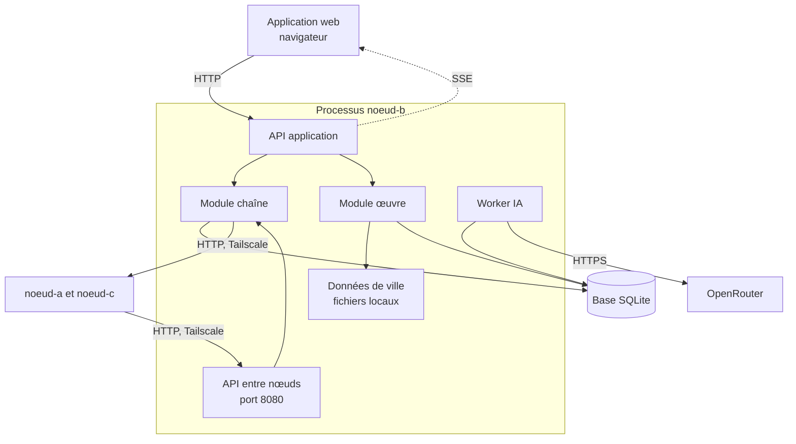

# Dossier de binôme 2 (noeud-b)

26/11/2026

Brouillon à relire par les deux avant le dépôt sur Moodle (vendredi 27/11, 17h). Ce dossier s'appuie sur la spec commune v1.0 sans la recopier : les numéros comme 4.2 ou 6.3 renvoient à ses sections. Un repère marque ce qui n'est pas figé : **\[À CONFIRMER\]**, proposition que le binôme doit valider. L'œuvre est décrite dans la bible DA, les valeurs et le prompt dans la charte éditoriale.

| Champ | Valeur |
| --- | --- |
| Binôme | 2 : Maxens Sevilla (`MaxX-J`) et Rahim Tamhaev (`withRen`) |
| Nœud | noeud-b (producteur d'un créneau de 20 s sur trois, ordre a, b, c) |
| Spec commune | version 1.0 du 23/11/2026 |
| Version du dossier | 0.7, une seule chaîne de balades |
| Langage | TypeScript, pour le nœud et pour l'application |

## 1. Le projet en bref

**Notre regard.** Une blockchain garde des paroles qu'on ne peut plus effacer ; une ville garde les pas de ceux qui la traversent. Nous faisons se rencontrer les deux : **chaque message devient une balade dans Béziers, qui repart d'où la précédente s'est arrêtée ; ensemble, elles dessinent le Béziers que les gens ressentent.** Les enseignants ont approuvé cette idée : une balade individuelle, puis toutes regroupées.

**Ce que permet l'application.** Le visiteur lit la consigne, écrit un message de 280 caractères au plus, puis reçoit sa balade : un titre, des étapes, une distance. Elle est d'abord en attente, puis tracée quand le message est entré dans un bloc et que l'IA l'a lu. Il peut explorer la carte commune, zoomer, et retrouver sa balade par un lien contenant l'id de son message. Avant d'écrire, il est prévenu que son message ne s'effacera pas, sera partagé avec les deux autres binômes et envoyé à une IA, et ne doit contenir aucune donnée personnelle (spec 8.1).

**Ce que montre l'œuvre.** Béziers en 2,5D (faux relief, sans modèle 3D). L'IA tire huit valeurs de chaque message : elles choisissent les lieux, la longueur, la couleur et la forme de la balade. Toutes les balades forment **une seule ligne** à travers la ville, comme les blocs de la chaîne. En passant, chaque balade change la ville : les rues empruntées prennent sa couleur, les bâtiments où elle s'arrête gagnent des étages, et chaque quartier prend l'émotion qui domine chez lui (sol, toits, arbres) et une lumière selon son humeur (jour, crépuscule ou nuit). Les messages des trois binômes suivent tous les mêmes règles ; seule la forme des étapes rappelle leur nœud d'origine.

**Ce qui est indispensable.**

- Écrire un message et le voir arriver dans la chaîne.
- Recevoir sa balade, et voir la carte commune changer à chaque message.
- Un nœud complet, qui passe les cas de test de la spec (section 10).
- Garder la trace du modèle d'IA qui a réellement répondu.

**Ce qui est en plus, si le temps le permet.** Passants et mobilier, objets incongrus, repères supplémentaires, panneau sur l'état de la chaîne, carte-souvenir à télécharger, animation d'apparition. Le détail est dans le backlog, rendu à part.

## 2. L'architecture

Les flèches montrent qui appelle qui. Tout ce qui est dans le cadre tourne dans un seul processus Node.js sur l'ordinateur du binôme. Le module chaîne est le centre : rien n'entre dans la chaîne sans passer par lui.

| Composant | Rôle | Où il tourne | Comment il parle aux autres |
| --- | --- | --- | --- |
| Application web | Écrire un message, afficher la ville, les balades et les quartiers | Navigateur du visiteur, fichiers servis par le nœud. Ouverte sur l'ordinateur du nœud et sur les machines du réseau Tailscale. | HTTP et flux d'événements SSE vers l'API de l'application |
| API application | Recevoir et filtrer les messages (charte, limite de 5 par visiteur et par 10 s), fournir l'œuvre, prévenir l'application | Processus noeud-b, port propre à l'application, distinct du 8080 et joignable par le réseau Tailscale seulement. | Appelle le module chaîne pour écrire, lit le module œuvre |
| Module chaîne | Texte canonique, id, signature, validation, file d'attente, production de blocs à notre créneau, rattrapage | Processus noeud-b | Lit et écrit la base. Envoie aux pairs et les interroge par un client HTTP (POST /messages, POST /blocks, GET /status). |
| API entre nœuds | Les cinq routes de la spec (6.3), les limites de débit (8.2) | Processus noeud-b, port 8080, joignable par le nom Tailscale noeud-b | HTTP et JSON avec noeud-a et noeud-c. Chaque objet reçu passe par le module chaîne. |
| Worker IA | Lire les messages de la chaîne sans résultat, appeler l'IA, enregistrer valeurs et statut | Processus noeud-b, tâche de fond | Lit la base, appelle OpenRouter, écrit dans ai\_results |
| Module œuvre | Calculer la balade de chaque message et l'état de chaque quartier | Processus noeud-b | Lit blocks, messages, ai\_results, hidden\_messages et les données de ville. Fournit balades et quartiers à l'API de l'application. |
| Données de ville | Rues, lieux, quartiers, fonds de carte et bâtiments, préparés une fois à l'avance | Fichiers du dépôt, lus au démarrage | Lecture seule, aucun appel à un service de cartes |
| Base SQLite | Chaîne, file d'attente, résultats IA, créneaux signés, journaux | Fichier local sur l'ordinateur du nœud | Accès direct par les modules du processus, sans réseau |
| Pairs (noeud-a, noeud-c) | Les deux autres nœuds de la chaîne | Ordinateurs des binômes 1 et 3 | Tailscale, HTTP sur le port 8080 |
| OpenRouter | Fournit les modèles d'IA gratuits | Internet | HTTPS, port 443, ouvert sur eduroam |

## 3. Le parcours d'un message

Un message passe par neuf étapes, de la saisie à sa balade dans la ville. Les numéros de spec indiquent la règle suivie à chaque étape.

| N° | Composant | Ce qui se passe | Si ça échoue |
| --- | --- | --- | --- |
| 1 | Application | Le visiteur lit l'avertissement (message non effaçable, partagé, envoyé à une IA, sans donnée personnelle), écrit son texte et valide. | Erreur affichée sous le champ, saisie conservée. |
| 2 | API de l'application (dans le nœud) | Mise en forme NFC, contrôle de la longueur (1 à 280 points de code) et des caractères interdits, filtre de la charte éditoriale, limite de 5 messages par visiteur et par 10 s (spec 2.1, 8.1, 8.2). | Refus avant signature : le message n'a ni id ni trace. |
| 3 | Nœud, module chaîne | Horodatage strictement croissant, texte canonique, id (SHA-256), signature Ed25519, écriture dans la file d'attente en base (spec 2.1, 3.1). | Erreur interne : le message n'est pas créé, le visiteur peut réessayer. |
| 4 | Nœud, module réseau | Envoi immédiat aux deux pairs par POST /messages, délai de 3 s, pas de nouvelle tentative (spec 6.4.1). | Le sondage de 10 s des pairs rattrape l'envoi raté (spec 6.4.3). |
| 5 | Nœud, producteur | À notre créneau, si la file n'est pas vide : appel de GET /status sur les pairs. Il faut qu'au moins un pair réponde, qu'aucun n'annonce une chaîne strictement meilleure (hors têtes ignorées, spec 7), ne pas être en SYNCING, ne pas avoir produit le dernier bloc et ne pas avoir déjà signé dans ce créneau ou un plus récent. Prise de 50 messages au plus, bloc signé entre la 2e et la 15e seconde, ajouté à la chaîne, envoyé aux pairs (spec 4.2). | Pas de bloc, les messages attendent le créneau suivant. |
| 6 | Nœud, module chaîne | Un bloc reçu d'un pair est validé (spec 3.2), ajouté, et ses messages sortent de la file. Une fourche déclenche le rattrapage (spec 5, 7). | 409 ou 422 selon la spec, journalisé. |
| 7 | Nœud, worker IA | Pour chaque message de la chaîne sans résultat en base, appel à OpenRouter, contrôle du format, enregistrement de message\_id, block\_index, modèle demandé, modèle utilisé, valeurs, status et processed\_at (spec 9). | Statut timeout, invalid\_format ou refused, valeurs par défaut pour le dessin. |
| 8 | Nœud, module œuvre | Les messages sont ordonnés par index de bloc puis position dans le bloc, jamais par timestamp (spec 5.3). La balade est calculée depuis les valeurs et l'id, sur les vraies rues ; l'état des quartiers traversés est mis à jour. | Balade neutre, avec les valeurs par défaut. |
| 9 | Application | Le nœud prévient l'application par un flux d'événements. La balade apparaît avec son titre, les quartiers changent de lumière, puis la balade est marquée stable. | Si le flux se coupe, l'application se reconnecte et relit l'état. |

**Stabilité.** Une balade est marquée stable quand 3 blocs ont suivi le sien.

**Visiteur.** Pour la limite de 5 messages par 10 s, un visiteur est reconnu par un cookie de session anonyme. L'effacer contourne la limite : c'est accepté.

**Cas d'une fourche.** Si une autre chaîne est adoptée, les messages de nos blocs abandonnés retournent dans la file (spec 5.2). Leurs résultats IA restent en base, car la clé est l'id du message (spec 9) : l'IA ne les relit pas. Les quartiers sont recalculés à partir de la nouvelle chaîne. La forme d'une balade ne change pas, car elle dépend seulement du message et de ses valeurs ; elle peut disparaître provisoirement, et la lumière d'un quartier peut changer. « Stable » est un repère d'affichage, pas une garantie : la spec n'a pas de finalité (5.3).

## 4. Les données

La chaîne et la file d'attente sont stockées sur disque, comme la spec l'exige (section 7). Nous y ajoutons les résultats de l'IA, qui restent chez nous (spec 9). Tout vit dans une seule base SQLite, dans un fichier local, avec des transactions pour chaque écriture liée.

| Table | Rôle | Colonnes principales |
| --- | --- | --- |
| blocks | Les blocs de notre chaîne | block\_index (clé, champ `index` de la spec), hash, previous\_hash, timestamp, producer, messages\_hash, signature |
| messages | Les messages, qu'ils soient dans un bloc ou en attente | id (clé), node, timestamp, content, signature, block\_index (vide tant que le message est en file), position |
| ai\_results | Un résultat IA par message (spec 9) | message\_id (clé), block\_index, model\_requested, model\_used, ai\_values (JSON, champ `values` de la spec), status, processed\_at, et pour nous : attempts, prompt\_version, raw\_response |
| hidden\_messages | Les messages masqués dans l'œuvre, jamais retirés de la chaîne (spec 8.1) | message\_id (clé), reason, hidden\_at |
| slot\_log | Les créneaux déjà signés, écrits avant la signature (spec 4.2.3) | slot (clé), block\_hash |
| node\_state | Le dernier timestamp émis, pour qu'il reste croissant après redémarrage (spec 2.1) | key, value |
| events\_log | Erreurs, doubles signatures et écarts d'horloge servant de preuve (spec 3.4, 8.3) | id, at, kind, peer, detail (JSON : pour une double signature, les deux blocs complets) |

Les noms suivent les champs de la spec (anglais, snake\_case, tables au pluriel) pour qu'un lecteur de la spec s'y retrouve. Deux noms diffèrent, car `index` et `values` sont des mots réservés en SQL : `block_index` et `ai_values`.

**Les données de ville.** Des fichiers versionnés, préparés une seule fois à partir d'OpenStreetMap, puis triés à la main :

| Fichier | Contenu |
| --- | --- |
| streets | Réseau de rues piétonnes : points et segments avec leur longueur |
| places | Environ 80 lieux : identifiant, famille (`lieu`), position, quartier, symbole |
| districts | Une dizaine de quartiers : contour et nom |
| tiles | Fonds de ville en images, de jour et de nuit, à plusieurs échelles |
| buildings | Bâtiments génériques et repères en SVG, avec leur emprise |

Chaque fichier porte un numéro de version, `map_version`. Les logements sont représentés par des quartiers, jamais par une adresse. La mention « © les contributeurs OpenStreetMap » est affichée sur la carte, et les données dérivées sont redistribuées sous la licence ODbL, indiquée à côté des fichiers.

**Ce qui est recalculé et non stocké.** Les balades et l'état des quartiers se calculent depuis les blocs, ai\_results, hidden\_messages et les données de ville ; ils sont seulement gardés en mémoire. Une fourche ne laisse aucun dessin à nettoyer. Si `map_version` change, les balades peuvent changer : nous la figeons avant la jonction.

**Hors base.** Les secrets sont dans un fichier .env non versionné (NODE\_ID, graine de la clé privée, clé OpenRouter, adresses des pairs, chemin de la base). Un .env.example versionné donne la liste des clés sans valeurs (référentiel, section 3.2). Les clés publiques des trois nœuds sont dans un fichier de configuration versionné.

**Sauvegarde.** La chaîne se récupère chez les pairs par rattrapage. Les résultats IA, eux, n'existent que chez nous : un export JSON de ai\_results est fait chaque jour de travail.

**Écarté.** Des fichiers JSON (écritures non atomiques, risque de fichier à moitié écrit après une coupure) et PostgreSQL (un serveur de plus à installer sur un ordinateur portable, sans bénéfice pour une chaîne de cette taille).

## 5. L'IA

**Quand.** L'IA lit un message seulement quand son bloc est dans notre chaîne (spec 9). Un worker en tâche de fond parcourt les messages de la chaîne qui n'ont pas encore de ligne dans ai\_results. Il n'y a aucun appel à l'IA à l'écriture : une panne d'IA ne bloque ni l'écriture ni la production de blocs.

**Quel modèle.** Modèles gratuits uniquement, via OpenRouter, avec un compte et une clé par étudiant, la clé étant dans le .env. Modèle demandé : nvidia/nemotron-3.5-super-vl:free, fixe pour garder une lecture régulière. Si les deux premiers appels échouent, le troisième va à openrouter/free, accepté par le sujet. Écarté : openrouter/free seul, car il change de modèle et les réponses varient. On enregistre model\_requested (celui de l'appel retenu) et model\_used, lu dans le champ model de la réponse (sujet, section 2).

**Le prompt.** Le message est encodé en JSON par le code, sous la forme {"message": "…"}, et placé dans le rôle user ; la consigne est dans le rôle system et demande d'ignorer tout ordre contenu dans le message. La réponse attendue est un objet JSON aux champs fixés. Les huit champs, leurs bornes et le prompt (`p4`, à réessayer) sont dans la charte éditoriale, partie 3 ; ce dossier ne les répète pas.

**Quand l'IA ne répond pas bien.**

| Situation | Ce que fait le nœud | status enregistré |
| --- | --- | --- |
| Pas de réponse en 20 s, erreur serveur ou 429 | Nouvel appel après 5 s, puis 15 s, tant que les 3 appels ne sont pas épuisés. Sur 429, pause générale du worker avant l'appel suivant. | timeout si le dernier appel échoue ainsi |
| Réponse hors format (pas du JSON, champ manquant, valeur hors bornes, champ en trop) | Nouvel appel avec le rappel du format, tant que les 3 appels ne sont pas épuisés. Les balises de code autour du JSON sont retirées ; les valeurs ne sont jamais corrigées en silence. | invalid\_format si le dernier appel échoue ainsi |
| Le modèle refuse de traiter le message | Aucune nouvelle tentative. | refused |
| Réponse correcte | Valeurs enregistrées telles quelles après validation. | ok |

Un message a droit à **3 appels au plus**, toutes causes confondues, pour économiser le quota gratuit. Ensuite sa ligne reste telle quelle. Pour tout statut différent de ok, la balade est tracée avec les valeurs par défaut de la charte (repère, neutre, nombres à 0) ; les vrais lieux viennent de l'id du message.

**Limites à connaître.** Nos essais à la main ont atteint la limite gratuite en quelques messages : le chiffre exact reste à relever, et le secours openrouter/free peut être bloqué par la même limite. On garde du quota pour le 10/12 et l'oral, et on code avec un faux serveur d'IA. Les modèles gratuits ont un quota par minute et par jour, à vérifier sur OpenRouter avant S50. Le worker traite donc un message à la fois. Les blocs acceptent 150 messages par minute au plus, et les limites par nœud en laissent entrer 120 (spec 8.2) : en cas d'afflux, la file IA prend du retard sans rien casser, mais un quota journalier trop bas peut laisser des balades neutres longtemps.

**Contre les injections.** Une réponse est acceptée seulement si elle passe un schéma strict. Un message qui tente de donner des ordres à l'IA ne peut au pire que choisir des valeurs dans les bornes. Aucun texte libre de l'IA n'est affiché : seulement des nombres et des mots de listes fermées. Le titre d'une balade est composé par le code avec les vrais lieux.

## 6. Des valeurs à l'œuvre

**Le chemin.** Les valeurs de ai\_results et l'ordre de la chaîne entrent dans le module œuvre. Il calcule deux choses : **la balade de chaque message**, et **l'état de chaque quartier**. L'application les reçoit et les dessine.

**La balade.** Fonction pure : mêmes valeurs, même id et même `map_version` donnent toujours la même balade.

1. La balade part de la dernière étape du message précédent dans la chaîne. Le premier message part d'un repère fixe.
2. `lieu` et `lieu_secondaire` donnent les familles ; `energie` donne le nombre d'étapes, de 2 à 6.
3. Les étapes sont choisies par l'id dans la famille, parmi les lieux proches.
4. Un plus court chemin (A*) relie les étapes sur le réseau de rues. Repasser au même endroit est permis. Longueur maximale d'un trajet, et trajet quand l'IA a échoué : **\[À CONFIRMER\]**.
5. `tension` déforme le tracé, sans le faire sortir de la rue.
6. `absurdite` à 0,5 ou plus pose un objet incongru (piano, baignoire, taureau, poisson volant) près d'une étape, choisi par l'id.

Si la chaîne change (spec 5), les balades sont recalculées depuis le premier bloc qui diffère.

**Le quartier.** Il regarde les 20 derniers messages de la chaîne passés chez lui. Chaque nouveau texte modifie donc l'effet des précédents, quel que soit le binôme qui l'a écrit.

| Valeur | Dans la balade | Dans la ville |
| --- | --- | --- |
| `lieu`, `lieu_secondaire` | Étapes, symboles | Bâtiments visités : étages en plus, teinte chaude |
| `emotion` | Couleur et motif du tracé | Couleur des rues empruntées ; émotion dominante du quartier : sol, toits, saison des arbres |
| `intensite` | Force de la couleur | |
| `valence` | | Lumière du quartier : moyenne de 0,12 ou plus, jour ; de -0,12 ou moins, nuit ; sinon, crépuscule ; sans message, jour |
| `energie` | Nombre d'étapes | |
| `tension` | Forme, souple à cassée | |
| `absurdite` | Objet incongru | Il reste dans la ville |
| Sans IA | Forme des étapes selon le nœud, distance | Fenêtres allumées : une par message récent du quartier ; lumière d'une rue selon le nombre de passages |

Les plages exactes, les couleurs et les motifs sont dans la [palette](../bible-da/palette.md), les effets dans la [ville vivante](../bible-da/ville-vivante.md).

**Le dessin, en couches.** De bas en haut :

1. Le fond de ville, en images préparées (jour et nuit). Le crépuscule superpose les deux. Chaque quartier est découpé par son contour, avec un fondu aux limites.
2. Les bâtiments : de loin, ils sont dans l'image. Au zoom, les SVG génériques et les repères remplacent la zone visible, avec leurs fenêtres numérotées à allumer.
3. Les tracés en SVG, au sol puis répétés en transparence au-dessus, pour rester visibles.
4. Les symboles des lieux, puis l'interface.

**Beaucoup de balades.** Une traînée suit la tête de la chaîne : les dernières balades sont nettes et s'estompent, la plus récente porte un point et un halo. Le nombre de balades de la traînée sera calibré sur l'œuvre. Les plus anciennes ne restent que dans la lumière des rues et la hauteur des bâtiments. Le visiteur retrouve toujours la sienne en entier.

**Message masqué.** Sa balade et ses effets sur la ville disparaissent ; un volet fermé marque le quartier. La balade suivante part toujours du même point. Le message reste dans la chaîne (spec 8.1) et son texte n'est jamais envoyé à l'application.

**Accessibilité.** Une liste des balades, lisible au clavier et au lecteur d'écran, double la carte : titre, émotion écrite, étapes, distance. La couleur est toujours doublée d'un symbole ou d'un motif. L'humeur et la lumière de chaque quartier sont écrites. Aucun clignotement rapide, animations coupées si l'utilisateur demande moins de mouvement.

**Écarté.** Une moyenne des tracés (une balade qui n'est celle de personne) ; des balades séparées (illisibles à 300) ; un réglage pour forcer le jour (la lumière fait partie de l'œuvre) ; la vraie 3D (trop longue, texte moins accessible) ; un service de cartes en direct (dépendance au réseau et à un tiers) ; un rendu fait par l'IA, non reproductible.

## 7. Les choix techniques

| Sujet | Choix | Pourquoi | Écarté |
| --- | --- | --- | --- |
| Langage | TypeScript en mode strict, sur Node.js (version LTS en cours, à vérifier à l'installation) | Un seul langage pour le nœud et l'application, types partagés pour les messages et les blocs. SHA-256 et Ed25519 existent dans le module crypto, sans bibliothèque (spec 2.1). | PHP ou Python : deux langages à maîtriser pour un seul projet. |
| API du nœud | Express | Recommandé par le référentiel, simple pour cinq routes (spec 6.3). | Fastify : bon, mais rien ne le justifie ici. |
| Validation | Zod en mode strict | Refuse les champs inconnus, null ou mal typés, comme la spec l'exige (section 2). | Validation écrite à la main : plus longue, plus d'oublis. |
| Calculs de la spec | crypto natif, normalize('NFC'), comptage par points de code, listes de caractères écrites en dur | trim() dépend du langage, la spec impose ses propres listes (2.1). | Bibliothèque de signature externe : une dépendance de plus pour rien. |
| Stockage | SQLite avec better-sqlite3 | Un fichier, transactions, aucun serveur (section 4). Module natif : installation à tester sur nos deux machines, `node:sqlite` en secours. | JSON ou PostgreSQL (section 4). |
| Appels entre nœuds | fetch natif avec délai (3 s, 10 s pour GET /blocks) | Les délais sont ceux de la spec (6.2). | Bibliothèque HTTP externe. |
| Application | React avec Vite, en TypeScript | Référentiel, composants réutilisables : balade, quartier, lieu, liste. | Page sans framework : le dessin et les états deviendraient difficiles à maintenir. |
| Mise à jour de l'application | Flux d'événements du serveur (SSE) | Un seul sens suffit : le nœud prévient, l'application écoute. | Socket.io : bidirectionnel, inutile ici ; interrogation régulière : plus lente. |
| Dessin | Fond en images découpées, tracés et bâtiments en SVG | Une ville de 11 725 bâtiments ne tient pas en SVG d'un coup : l'image sert de loin, le SVG de près, où l'on allume des fenêtres et change des couleurs. | Tout en SVG (trop lourd), Canvas ou Three.js (texte moins accessible). |
| Données de carte | OpenStreetMap, téléchargé une fois | Libre, vraies rues et vrais lieux. Le serveur public s'est montré saturé pendant nos essais : la carte est gardée dans le dépôt. | Google Maps (conditions d'usage et appels en direct). |
| Chemins | A* écrit par nous sur le réseau de rues | Réseau petit (7 380 points dans l'esquisse), résultat reproductible. | Service d'itinéraire en ligne. |
| Journaux | pino | Journaux structurés, utiles pour les preuves de la spec (3.4, 8.3). | console.log seul. |
| Qualité | ESLint, Prettier, tsc strict | Erreurs trouvées avant l'exécution. | Aucun contrôle. |
| Exécution | Le nœud tourne directement sur l'ordinateur du binôme, hôte Tailscale nommé noeud-b. Trois instances locales, sur trois ports, servent aux essais. | Tailscale tourne déjà sur la machine, rien d'autre à installer. | Docker : une couche réseau et un outil de plus, sans bénéfice ici. |
| Fonctionnement réseau | Tailscale, port 8080, adresse IP en secours (spec 6.1) | Imposé par le sujet et la spec. | Aucun. |

**Machine du nœud.** L'ordinateur de MaxX-J héberge noeud-b le 10/12. S'il est éteint, notre créneau reste vide et les deux autres nœuds continuent (spec 7). Celui de withRen sert de secours : il faut alors y copier la base et la clé privée, sans jamais faire tourner les deux en même temps (double signature).

**Pour reprendre le projet.** Le dépôt suit l'arborescence du référentiel : docs/, infra/, src/ (nœud, application, code commun), tests/ (dont tests/vectors/), .github/, .env.example, .gitignore, README.md. Le README donne l'installation (npm install), la copie de .env.example vers .env, le lancement du nœud et de l'application, et la commande des tests.

## 8. Les tests

Quatre niveaux, du plus simple au plus large. L'horloge du nœud est injectée dans le code : les cas de la spec qui demandent une heure simulée (1796889615000) sont donc rejouables sans attendre.

| Niveau | Ce qu'on vérifie | Comment | Quand |
| --- | --- | --- | --- |
| Notre nœud seul | Les vecteurs de la spec : id b3bca9b7…, hash du bloc 1 7c8f7209…, bloc zéro 9af1db54…, signatures à l'identique. Les cas 1 à 14, 17 à 19 et 22, plus 23 et 24 simulés avec une horloge et de faux pairs (la spec les classe en essais sur le réseau : ils sont aussi rejoués à trois). Les règles de validité, l'ordre des messages, le choix entre deux chaînes. | Tests unitaires et tests d'API avec Vitest, sans réseau, clés de test de la spec (section 10.1). | Lundi 07 et mardi 08/12. En S49, préparation sans code du projet ; script de vecteurs seulement si les enseignants l'acceptent |
| Notre nœud avec les deux autres | Les cas 15, 16, 20, 21 et 23 à 26 (fourche, rattrapage, redémarrage, isolement). Puis les étapes du jour J (spec 10.3). | D'abord trois instances de notre propre nœud sur un même ordinateur, avec les clés de test. Ensuite, deux nœuds réels sur Tailscale (mercredi 09/12), puis les trois (jeudi 10/12). | Local en S50, réel les 09 et 10/12 |
| Balades et quartiers | Même message, même balade. Les bornes de chaque valeur. Une fourche et un message masqué recalculent les quartiers. Aucun lieu sans chemin. | Tests unitaires avec des messages fixes et une petite carte de test | S50 et S2 |
| Application de bout en bout | Le parcours complet de la section 3 : écriture, bloc, IA, balade. Les pannes d'IA. L'accessibilité. | Playwright, avec un faux serveur OpenRouter qui simule réponses correctes, lentes, hors format, refus et 429. Contrôle axe et test clavier. Validation W3C du HTML. | De S50 à S2 |

**Notre part des cas partagés.** La spec nous confie la production des entrées des cas 11 à 14 et 17 à 19, à déposer dans tests/vectors/ du dépôt commun avant le lundi 07/12 au soir (spec 10.2). Nous les utilisons aussi dans nos propres tests.

**Critère de fin.** Un test qui échoue sur un vecteur de la spec est une erreur de notre code, sauf si deux binômes lisent la spec différemment : dans ce cas, on corrige la spec avant le code (spec 10.3).

## 9. Les risques

| Risque | Type | Ce que nous prévoyons |
| --- | --- | --- |
| Nos calculs d'empreinte ou de signature diffèrent de ceux des autres (NFC, points de code, espaces) | Technique | Vecteurs de la spec rejoués dès le lundi 07/12. Listes de caractères écrites en dur, jamais trim(). |
| Les noms Tailscale ne se résolvent pas (point ouvert O2) | Technique | Adresses IP en configuration locale, test des noms le lundi 07/12. |
| Horloge déréglée, blocs refusés (fenêtre de 5 s) | Technique | Synchronisation automatique du système, avertissement au-delà de 2 s (spec 6.4.3). |
| Redémarrage au milieu d'un créneau, double signature | Technique | Créneau écrit en base avant de signer (table slot\_log, spec 4.2.3). |
| Modèle gratuit en panne ou quota atteint | Technique | Section 5 : tentatives, statut enregistré, valeurs par défaut. L'IA ne bloque jamais la chaîne. |
| Fuite de la clé privée ou de la clé OpenRouter | Technique | .env hors de Git, .gitignore dès le premier commit, analyse des secrets sur le dépôt. En cas de fuite : on prévient les six (spec 8.4). |
| Texte choquant produit par l'IA ou par un visiteur, affiché dans l'œuvre | Technique | Filtre avant signature, valeurs bornées, aucun texte libre de l'IA, balade retirée pour un message masqué. |
| Ville lente à afficher | Technique | Fond en images, SVG seulement dans la zone visible et allégés, nombre de tracés limité. Essai à 300 messages avant la fin de S2. |
| OpenStreetMap incomplet ou mal classé | Technique | Tri à la main d'environ 80 lieux, positions vérifiées. |
| Trop de balades au même endroit (un seul cimetière dans le centre) | Technique | Plusieurs lieux par famille, lieu de départ choisi par l'id, zone élargie si besoin. |
| Une balade blesse (lieu de culte, deuil, domicile) | Humain | Aucun détail moqueur dans ces lieux, religions non distinguées, aucune adresse. |
| Peu de temps de production : 3 jours de S50 (7 au 9/12) avant la jonction du 10/12 | Temps | Backlog classé en indispensable et en plus. Nous préparons chez nous en S49 : environnement, tri des lieux, essais du prompt à la main. |
| La direction artistique prend plus de temps que prévu | Temps | Les bâtiments sont déjà dessinés en brouillon. Ordre de coupe : passants et mobilier, objets incongrus, étages des bâtiments, bâtiments au zoom, nuit. Il reste des blocs simples et les balades. |
| Un des deux est absent ou chargé par d'autres cours | Binôme | Les deux relisent tout le code. Journal d'avancement dans docs/suivi/. Chacun doit pouvoir expliquer l'ensemble à l'oral. |
| Charge déséquilibrée entre les deux, note individualisée | Binôme | Répartition visible dans le backlog, point d'équilibre chaque semaine. |
| Code écrit avec l'IA et mal compris | Binôme | Section 10 : relecture et explication obligatoires avant fusion. |

## 10. L'organisation

**Qui fait quoi.** Répartition indicative, qui peut évoluer ; le détail tâche par tâche est dans le backlog.

| Zone | Contenu | Responsable | Relecteur |
| --- | --- | --- | --- |
| Calculs, validation, production | Vecteurs, base, créneaux | MaxX-J | withRen |
| Routes et rattrapage | Les cinq routes, fourche, SYNCING | withRen | MaxX-J |
| Écriture | Page d'écriture, API de l'application, filtre | withRen | MaxX-J |
| IA, carte commune, styles, zoom | Worker, quartiers, dessin | withRen | MaxX-J |
| Balade calculée, vue d'un parcours, accessibilité | Chemins, titre, liste | MaxX-J | withRen |
| Tests et jonction | Vecteurs, cas partagés, bout en bout | les deux | les deux |
| Documents de rendu | Rédigés et relus à deux : MaxX-J surtout la charte et le dossier, withRen surtout les dessins de la bible DA | voir contenu | les deux |

**Travailler à deux.** Un daily chaque matin, dix minutes, avec l'enseignant (le premier mardi 24/11), puis un court point entre nous en fin de journée pour ce qui est fait et ce qui bloque. Pendant S49, un message par jour suffit. Les six se parlent sur Discord (spec 11), et nous deux sur un canal propre au binôme.

**Git.**

- Dépôt GitHub public du binôme, avec nos deux noms et aucun nom des autres binômes, équipe enseignante invitée **\[À CONFIRMER\]**.
- `CLAUDE.md` et `docs/suivi/journal/` partagent le contexte entre nous deux.
- Branches feat/, fix/, hotfix/ et chore/, une branche par tâche. Rien n'est poussé directement sur main.
- Commits courts et atomiques. Une pull request par tâche, relue par l'autre membre avant fusion.
- Une issue pour chaque grosse tâche, avec le contexte et les sources.
- Dossier docs/ pour centraliser les rendus, les schémas et les liens utiles, versionné avec le code.
- Secrets uniquement dans .env, jamais dans un commit.

**L'IA pour concevoir.** Nous arrivons avec nos idées, nous les soumettons à Claude, et nous gardons, changeons ou refusons ses retours. Quelques exemples :

- **Nos idées :** la ville (withRen), les balades dans Béziers (piste de l'enseignante d'art, choisie à deux), les bâtiments, les passants et le jour et la nuit (withRen), la lumière selon la `valence`, la chaîne unique de balades et les bâtiments qui grandissent (MaxX-J).
- **Retours gardés :** l'IA hors de la chaîne, le jour et la nuit par quartier, le liseré et le contraste de la palette.
- **Retours refusés ou corrigés par nous :** la valeur `sociabilite`, le `mot` libre, le ruban de couleurs au sol (jugé laid à l'essai), l'ordre des tâches du backlog et la palette de nuit (retours de withRen).
- **Ce que nous vérifions :** les choix sont décidés par nous, le journal `docs/suivi/` dit qui a décidé quoi.

**L'IA pour coder.** Le sujet l'autorise ; à l'oral, chacun doit expliquer tout ce que le binôme a produit. Nos règles :

- L'IA propose, nous relisons, lançons les tests et comprenons chaque ligne avant de fusionner.
- Aucune clé, aucun secret ni message de test réel dans une demande à l'IA.
- Les vecteurs de la spec font foi : si le code de l'IA et un vecteur divergent, c'est le code qui a tort.
- Nous gardons un journal court des usages (quoi, pour quelle tâche, ce qui a été corrigé) dans docs/suivi/.

**Calendrier.** S48 : conception et rendus. S49 : chacun prépare son environnement (Node, Tailscale, OpenRouter) et les données de ville, sans code du projet. S50 : production ; nœud prêt aux vecteurs le lundi 07/12, essai à deux le mercredi 09/12, jonction à trois le jeudi 10/12. S2 : finalisation et oral. Le plan jour par jour est dans le backlog.
